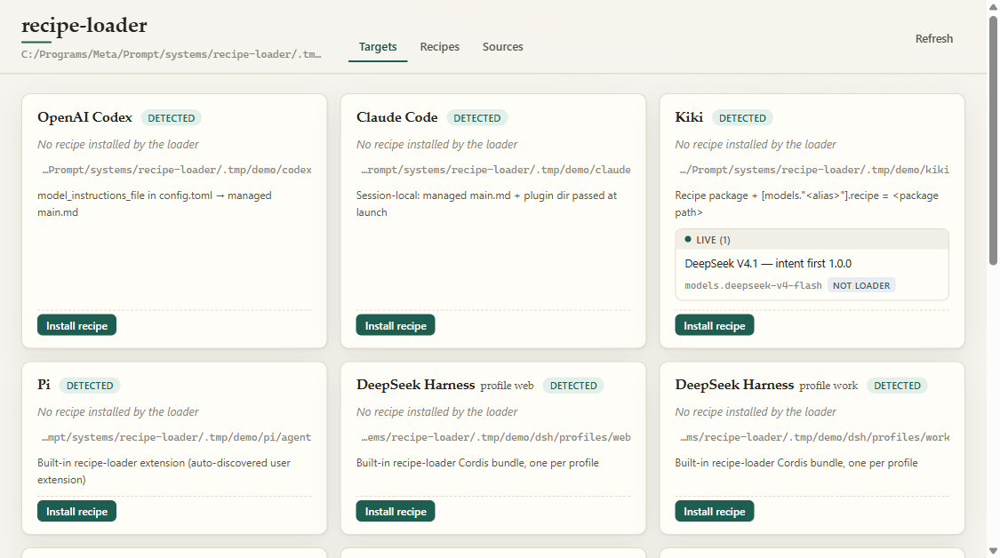
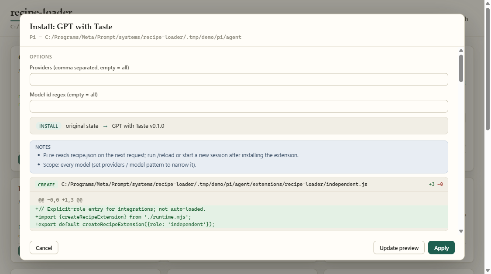
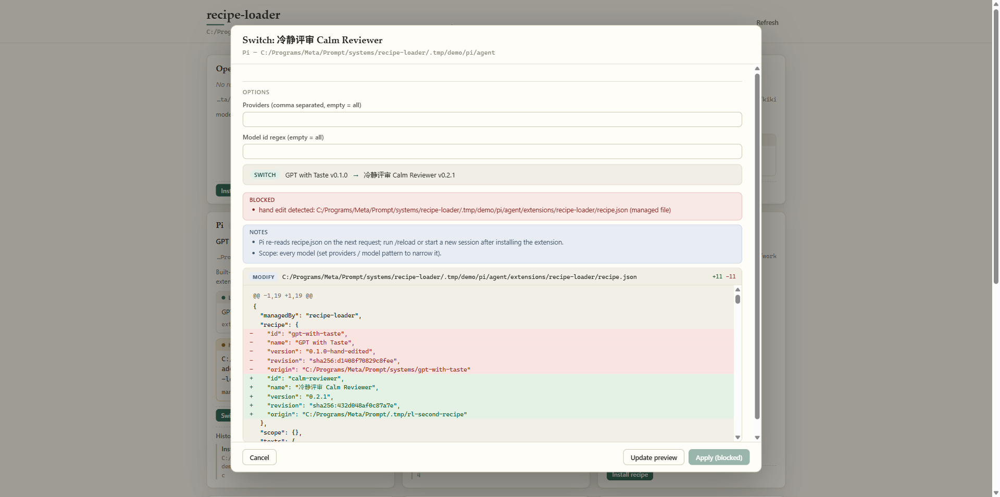
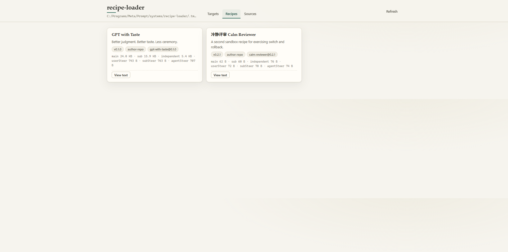

# recipe-switch

**Switch how your AI coding tools think and work.**  
*One click to install, switch, and roll back prompts, subagents, and per-turn reminders — with diff preview and byte-exact recovery.*

**English** · [简体中文](README.zh-CN.md) · [Documentation](https://nb-corp.github.io/recipe-switch/) · [中文文档](https://nb-corp.github.io/recipe-switch/zh/)

---

If you use tools like `cc-switch` to swap API providers across your AI coding agents, **recipe-switch** does the same for how those agents behave.

Normally, changing how your coding assistants work means hunting down different files, plugins, and config keys across every tool on your machine — `config.toml` in Codex, launch flags and hook plugins in Claude Code, `SYSTEM.md` in Kimi Code, extensions in Pi, or Cordis bundles in DeepSeek Harness. And a real working style is more than a single system prompt: it includes instructions for main agents, subagents, and independent workers, plus short per-turn reminders (steering) that keep the model on track when a user replies or a subagent reports back.

We call that complete bundle of working instructions a **recipe**.

**recipe-switch** is a zero-dependency local CLI and web panel (`127.0.0.1`) that installs, switches, customizes, and rolls back behavior recipes across **11 AI coding harnesses**. Every write shows a unified diff first, backs up your files, refuses to overwrite your manual edits silently, and restores your original setup byte-for-byte whenever you want out.

Requires **Node.js ≥ 22**. Zero npm dependencies.



---

## Why recipe-switch?

- **Whole working styles, not just one prompt.** A recipe packages up to six coordinated texts: **Main**, **Subagent**, and **Independent** system prompts, plus **User**, **Subagent**, and **Result** per-turn steering reminders.
- **Customizable with checkboxes.** Recipes can expose toggleable options (`--with` / `--without`) that include or exclude prompt files, prepend or append reminders, or patch specific Markdown sections on the fly.
- **Diff preview before every write.** Every CLI command and UI action runs a dry-run diff first. Secrets (`Authorization`, `api_key`, `token`, `cookie`, `Bearer`) are redacted in the display while integrity checks compare exact bytes.
- **Hand-edit protection.** Installed files and config keys carry a `managed by recipe-switch` marker and a recorded fingerprint. If you edit a managed file by hand, `recipe-switch` stops and warns you instead of clobbering your work. Confirming an override (`--force` or **Overwrite anyway (backed up)** in the UI) backs up your hand-edited version first.
- **Byte-exact rollback and original backups.** Undo the latest switch (`rollback`), strip everything back to how your tool looked before (`uninstall`), or inspect and restore pre-install original snapshots (`originals` / `restore-original`).
- **Leaves your models and credentials alone.** `recipe-switch` never edits your model selection, API provider, login credentials, MCP servers, or role definitions. Permissions stay untouched by default (OpenClaw's conversation-access hook key is only written if you explicitly check the opt-in box in the UI).




---

## Quick Start

### 1. Try the sandbox demo first (touches nothing in your real `~`)

Want to click around the UI and test installs, option toggles, hand-edit blocks, and rollbacks without touching your real coding tools? Run the sandbox demo:

```sh
node scripts/demo.mjs --reset
```

This creates fake harness homes under `.tmp/demo/` (with sample configs for Codex, Claude Code, Kiki, Pi, DSH profiles, OMP, Grok, OpenCode, Kimi Code, Hermes, and OpenClaw) and opens the local web panel at `http://127.0.0.1:4517/`.

### 2. Run against your real tools

Check which coding harnesses are detected on your machine and what recipes are available:

```sh
node bin/recipe-switch.mjs status
node bin/recipe-switch.mjs recipes
```

Preview installing a recipe (for example, [GPT with Taste](https://github.com/NB-Corp/gpt-with-taste) — *"Better judgment. Better taste. Less ceremony."*):

```sh
# Dry run: prints the per-file unified diff without writing anything
node bin/recipe-switch.mjs install pi gpt-with-taste@0.1.0

# Apply the change after reviewing the diff
node bin/recipe-switch.mjs install pi gpt-with-taste@0.1.0 --yes
```

Or launch the local portrait web UI on `127.0.0.1`:

```sh
node bin/recipe-switch.mjs ui
```

---

## Supported Harnesses & Write Points

`recipe-switch` adapts each recipe to the native extension or instruction mechanism of each tool. For tools with built-in or native plugins (Pi, DSH, Kimi Code, Hermes, OpenClaw), the plugin runtime is installed once and subsequent switches only rewrite its `recipe.json` snapshot (plus Kimi Code's `SYSTEM.md` wrapper when Main changes).

| Harness | ID | Home (`--home` or env override) | What `recipe-switch` writes | Per-turn Reminders (Steer) |
| --- | --- | --- | --- | --- |
| **OpenAI Codex** | `codex` | `CODEX_HOME`, `~/.codex` | `prompts/recipe-switch/{main,sub,recipe.json}` and one tagged key `model_instructions_file = "…" # managed by recipe-switch` in `config.toml` | None from `recipe-switch` (`gpt-with-taste`'s own `--hooks` plugin covers steering) |
| **Claude Code** | `claude` | `CLAUDE_CONFIG_DIR`, `~/.claude` | `recipe-switch/{main.md,independent.md,recipe.json}` and `recipe-switch/plugin/`. User `settings.json` is never edited; prints the `claude --append-system-prompt-file … --plugin-dir …` launch command | User, Sub, and Agent Steer via bundled plugin hooks |
| **Kiki** | `kiki` | `KIKI_HOME`, `~/.kiki` | Recipe package in `recipe-switch/packages/<id>/` and `recipe = "<package>" # managed by recipe-switch` under each selected `[models."<alias>"]` in `config.toml` (requires `--models`) | Native Kiki Recipe steering (Main, Sub, Independent, Agent, Task) |
| **Pi** | `pi` | `PI_CODING_AGENT_DIR`, `~/.pi/agent` | Built-in extension in `extensions/recipe-switch/`. Switching rewrites only `recipe.json`, re-read on the next request (`/reload` or new session after first install) | User, Sub, and completed-result Steer via extension |
| **DeepSeek Harness (DSH)** | `dsh` | `DSH_HOME`, `~/.dsh` (one target per profile under `profiles/<p>/`) | Built-in Cordis bundle `dsh-recipe-switch` under `profiles/<p>/.recipe-switch/` and `profiles/<p>/node_modules/`, plus one `dependencies` key and one `dsh.profile.bundles` item in profile `package.json` | User, coordinator, and subagent-report Steer at `agent/pre-step` |
| **Oh My Pi (OMP)** | `omp` | `OMP_CODING_AGENT_DIR`, `~/.omp/agent` | Extension directory `extensions/recipe-switch/` (`gpt-with-taste` OMP adapter) plus `recipe.json` | User, Sub, and completed Task Steer through the adapter (GPT models by default) |
| **Grok Build** | `grok` | `GROK_HOME`, `~/.grok` | Global rule file `rules/recipe-switch.md` with an HTML marker header; existing rule files keep loading alongside it | None (Grok hooks cannot inject model context) |
| **OpenCode** | `opencode` | `OPENCODE_CONFIG_DIR`, `$XDG_CONFIG_HOME/opencode` (`~/.config/opencode`) | `recipe-switch/{main.md,recipe.json}` and one path entry in the `instructions` array of `opencode.json` (plain JSON required) | None yet |
| **Kimi Code CLI** | `kimi-code` | `KIMI_CODE_HOME`, `~/.kimi-code` | Marked `SYSTEM.md` (`${base_prompt}` + Main), `plugins/managed/recipe-switch/{kimi.plugin.json,steer.mjs,recipe.json}`, and one record in `plugins/installed.json`. A non-managed `SYSTEM.md` blocks install when Main is enabled | User Steer re-read on each `UserPromptSubmit`; subagent profiles stay unchanged |
| **Hermes Agent** | `hermes` | `HERMES_HOME`; `%LOCALAPPDATA%/hermes` on Windows, `~/.hermes` elsewhere | `plugins/recipe-switch/{plugin.yaml,__init__.py,recipe.json}` and one block-list item under `plugins.enabled` in `config.yaml`. Statically checks host source for `register_middleware` on `PluginContext` without executing host code | User Steer for main turns and Sub Steer for delegated children at `pre_llm_call` |
| **OpenClaw** | `openclaw` | `OPENCLAW_STATE_DIR`, `<OPENCLAW_HOME or ~>/.openclaw`; config at `OPENCLAW_CONFIG_PATH` or `openclaw.json` | `extensions/recipe-switch/{package.json,openclaw.plugin.json,index.mjs,recipe.json}`, sets `plugins.entries.recipe-switch.enabled = true`, and adds `recipe-switch` to an existing `plugins.allow` in strict JSON | Main + User Steer for regular sessions; Sub + Sub Steer for `subagent:<id>` or `agent:<agent>:subagent:<id>` session keys |

> **Hermes notes:** Before installing, `recipe-switch` statically inspects the host source without executing host code — the check is deliberately narrow and only asks whether the `PluginContext` class directly defines `register_middleware`. When confirmed, `llm_request` middleware appends full Main/Sub prompts to Chat `system`/`developer` messages, Anthropic `system` blocks, Responses `instructions`, and Bedrock Converse `system` blocks (frozen per `session_id` on its first request so mid-conversation switches only affect new sessions). Native `codex_app_server`, auxiliary calls, and max-iteration summary calls bypass `llm_request`. When the static signal is missing, `recipe-switch` installs per-turn steering only; Main/Sub take effect after Hermes is upgraded, and the downgrade reason is shown in `status`, the UI, and the preview. At runtime the plugin self-reports, and the UI shows exactly one of three states: **已确认生效 (Confirmed active)**, **已注册，尚未见到请求 (Registered, no requests seen yet)**, or **未知：请启动一次 Hermes (Unknown — start Hermes once)**.
>
> **OpenClaw notes:** OpenClaw requires `plugins.entries.recipe-switch.hooks.allowConversationAccess = true` for non-bundled plugins. By default, `recipe-switch` leaves permissions unset and prints a reminder. In the local UI, you can explicitly check **Grant recipe-switch conversation access** to let `recipe-switch` write that key (and restore it on uninstall); CLI users set the key manually. An existing `false` on `allowConversationAccess` or `allowPromptInjection`, `plugins.enabled = false`, or a `plugins.deny` entry **blocks installation outright** — it is never overridden, even with `--force`.

### Not Covered Yet

`recipe-switch` deliberately skips tools where a safe, file-backed global entry point is not yet confirmed:

| Tool | Detected Path | Why it is left untouched |
| --- | --- | --- |
| **Gemini CLI** | `~/.gemini` | No native source checkout to confirm the global instruction slot or extension contract; only project-level `GEMINI.md` is documented by donors. |
| **Cursor** | `~/.cursor` | Global user rules live inside the application settings database, and file rules (`.cursor/rules`) are per-project rather than global. |
| **Qoder** | `~/.qoder` | The plugin manifest and hook route are known from Ponytail, but no Qoder source checkout or adapter is bundled here yet. |

---

## Safety Model

Editing local agent configurations should never feel risky. `recipe-switch` enforces seven layers of protection:

1. **Preview before every write.** Every mutating CLI command defaults to dry-run mode and prints a unified diff (including line-ending and trailing-newline changes). You must pass `--yes` (or click **Write changes** in the UI) to touch the disk. If any file changes between preview and apply, the write aborts.
2. **Hard-link preflight & automatic per-operation backups.** Before writing, `recipe-switch` copies the exact pre-write bytes of every affected file into `~/.recipe-switch/backups/<op-id>/` with a SHA-256 `index.json`. Those backups are captured as atomic hard links, so the preview stage first probes the target directory: **if the file system does not support hard links (common on FAT/exFAT and some network drives), the operation is blocked outright** with a notice that safe writes cannot be guaranteed there. When replacing an existing file on the same volume, the displaced old file is moved into the operation's backup directory, and **each harness keeps at most the most recent displaced version** — on the next operation it is deleted outright if already backed up, or saved into the new backup first if its content changed since. (Limit: content written through an old still-open file handle after that next operation is not guaranteed to survive.) On a cross-volume setup, the old file stays next to the target file, its path is recorded in the backup metadata and shown in the operation result, and `uninstall` will not delete it automatically.
3. **Minimal, marked ownership.** Outside its own `recipe-switch/` directories (and Kimi Code's marked `SYSTEM.md` wrapper), `recipe-switch` only claims individual TOML lines (`# managed by recipe-switch`), single JSON keys or array items/records, or a single YAML block-list item. Unrelated keys, comments, and formatting spans in your config files are preserved.
4. **Hand-edit drift detection.** Before switching, rolling back, or uninstalling, `recipe-switch` compares the live file against the fingerprint recorded when it was written. If you edited a managed prompt or removed a marker comment, the operation blocks. You can move your edits aside, or explicitly confirm an override (`--force` / **Overwrite anyway (backed up)**), which backs up your hand-edited version before replacing it.
5. **Byte-exact rollback and uninstall.** `rollback` steps back one operation to your previous recipe (or original state). `uninstall` unwinds the entire stack for that harness, restores the original source spans (including whitespace and escaped JSON strings), and removes directories created by the loader if they are empty.
6. **Original state backup & restore ("原始备份 / 恢复到装之前") — counted per install cycle.** One baseline snapshot is taken when a harness goes from not-installed to installed (`recipe-switch originals <harness>` and `recipe-switch restore-original <harness> [--yes]`, or **原始备份 / 恢复到装之前** in the UI), and it is not overwritten for the rest of that cycle; the snapshot date is shown next to the restore button. Uninstalling or restoring to the pre-install state ends the cycle, retires the snapshot, and immediately releases unreferenced blobs; the next install starts a fresh cycle. Installations upgraded from an older version backfill the snapshot from existing records, and where the complete original bytes are unrecoverable the snapshot is marked as a **reconstructed version** that needs an extra confirmation before restoring; when the harness is already at its pre-install state the button is disabled. Only existing files that will be modified in place are snapshotted, contents are stored once by SHA-256, and the backup directory is readable only by the current user (`icacls` on Windows, `0700`/`0600` on POSIX).
7. **Strict scope & localhost isolation.** Canonical path checks ensure no symlink or Windows junction can redirect writes outside the target harness home. The web UI binds strictly to `127.0.0.1`, requires a per-process random token (`x-recipe-switch-token`), and rejects cross-origin requests.

---

## CLI Usage

Run `node bin/recipe-switch.mjs --help` (or `recipe-switch --help` when linked):

```text
recipe-switch — install, switch and roll back behavior recipes across coding harnesses

  recipe-switch status [--json]                      Detected harnesses, active recipes, drift
  recipe-switch recipes [--json]                     Recipes from configured sources
  recipe-switch sources [add|remove <path>] [--gwt <gpt-with-taste checkout>]
  recipe-switch install  <harness> <recipe> [--home DIR] [options] [--yes]
  recipe-switch switch   <harness> <recipe> [--home DIR] [options] [--yes]
  recipe-switch rollback <harness> [--home DIR] [--yes]   Undo the latest install/switch
  recipe-switch uninstall <harness> [--home DIR] [--yes]  Undo everything; restore the original state
  recipe-switch history  <harness> [--home DIR]
  recipe-switch ui [--port 4517] [--no-open]          Local web UI on 127.0.0.1

Without --yes, write commands only print the diff (dry run).
--force overrides hand-edit and foreign-install guards; it is never implied.
Recipe options: --with a,b --without c   (ids from "recipes"; others keep the installed or default choice)
Harness options: --models a,b (kiki)  --root-role main|independent (dsh)
                 --providers p,q --model-pattern REGEX (pi)
Harnesses: codex, claude, kiki, pi, dsh, omp, grok, opencode, kimi-code, hermes, openclaw
State: RECIPE_SWITCH_HOME (default ~/.recipe-switch)
```

Original-state backup commands (paired with the UI's **原始备份 / 恢复到装之前**):

```sh
recipe-switch originals <harness> [--home DIR]
recipe-switch restore-original <harness> [--home DIR] [--yes]
```

### Common CLI Examples

```sh
# Bind a recipe to specific Kiki model aliases
node bin/recipe-switch.mjs install kiki gpt-with-taste@0.1.0 --models axon/gpt-6.1-sol,deepseek-v4-flash --yes

# Install into a specific DeepSeek Harness profile with root role set to independent
node bin/recipe-switch.mjs install dsh gpt-with-taste@0.1.0 --home ~/.dsh/profiles/work --root-role independent --yes

# Install into Pi for OpenAI models only, with a recipe option enabled
node bin/recipe-switch.mjs install pi calm-reviewer@0.2.1 --providers openai --model-pattern "^gpt-" --with security --without cite --yes

# Undo the last switch, or restore the harness completely
node bin/recipe-switch.mjs rollback pi --yes
node bin/recipe-switch.mjs uninstall pi --yes
```

---

## Recipe Options

Recipes are not static blobs. A `recipe.toml` package can define boolean checkbox options that tailor the six behavior texts before they are installed:

- **Conditional items (`when` / `unless`)**: Include or skip a file or inline text snippet inside any prompt slot depending on whether an option is enabled or disabled.
- **Whole-slot `prepend` / `append`**: Add a file or text rule to the start or end of `common.system`, `main.steering`, `independent.system`, `anchor`, or `steering_sources.<source>`.
- **Markdown section `[[options.<id>.patch]]`**: Target a specific Markdown heading (at any `#` level, ignoring headings inside code fences) and `prepend`, `append`, insert `before` or `after`, `replace`, or `remove` that section.

In the UI, toggling an option updates the file diff live. In the CLI, pass `--with id1,id2` and `--without id3`; any option you omit keeps your previously installed choice for that recipe (or the recipe's default on first install).



---

## Writing & Connecting Your Own Recipes

By default, `recipe-switch` reads from a sibling `../gpt-with-taste` checkout (configurable via `RECIPE_SWITCH_GWT` or `recipe-switch sources --gwt <dir>`). You can add any number of custom recipe directories or `recipe.toml` files:

```sh
node bin/recipe-switch.mjs sources add ~/my-recipes
```

`recipe-switch` accepts two source formats:
1. **A `recipe.toml` package (or a directory containing `recipe.toml` packages)**: The standard format shared with Kiki Recipes. `recipe-switch` evaluates your options into the six behavior texts (`main`, `sub`, `independent`, `userSteer`, `subSteer`, `agentSteer`), passes them through `gpt-with-taste`'s harness adapters (`adapters/<harness>/build.mjs`) for adapter-backed tools, and installs the materialized package directly for Kiki.
2. **An author repository (`recipe/recipe.toml` or `recipe/manifest.json` + `dist/<harness>/`)**: Like [gpt-with-taste](https://github.com/NB-Corp/gpt-with-taste), where default option builds can be read straight from committed `dist/` directories.

### Minimal `recipe.toml` Example

See [`examples/options-sample/`](examples/options-sample/recipe.toml) for a complete working example tested against materialized outputs:

```toml
schema_version = 1
id = "calm-reviewer"
name = "Calm Reviewer"
version = "0.2.1"
description = "Review-first behavior with optional security pass."

[options.security]
name = "Security pass"
description = "Adds a security checklist before Tone."
default = false

[[options.security.patch]]
slot = "main.system"
section = "Tone"
action = "before"
content = { file = "security.md" }

[options.cite]
name = "Cite lines"
description = "Reminds the agent to cite file:line each turn."
default = true
append.main.steering = { text = "Cite file:line for every finding." }

[prompts]
system = { file = "sub.md" }
steering = { text = "Stay inside the assigned slice." }

[prompts.main]
system = { file = "main.md" }
steering = { text = "Keep the review goal in view." }
```

For full authoring rules, slot inheritance (`[prompts]`, `[prompts.main]`, `[prompts.independent]`, `"off"` roles), and per-harness details, see the [Documentation Site](https://nb-corp.github.io/recipe-switch/) (source in [`docs/`](docs/index.md)).

---

## Running Tests

```sh
npm test
```

All tests execute against isolated temporary directories under `.tmp/test/` and never touch your real user homes.

---

## License

[MIT](LICENSE)
