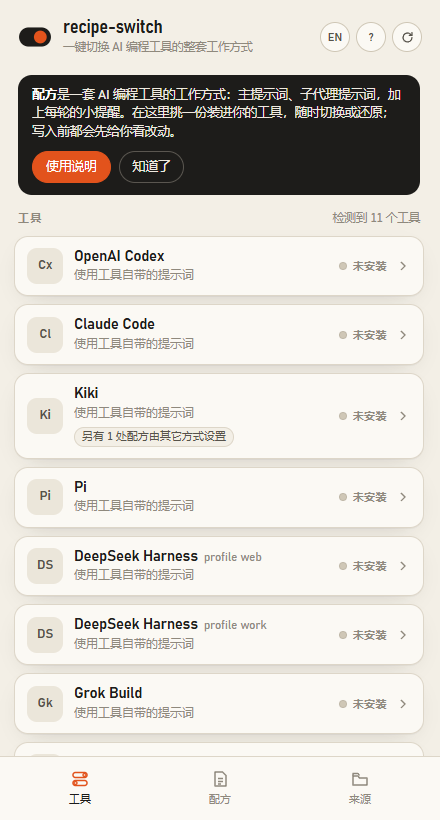
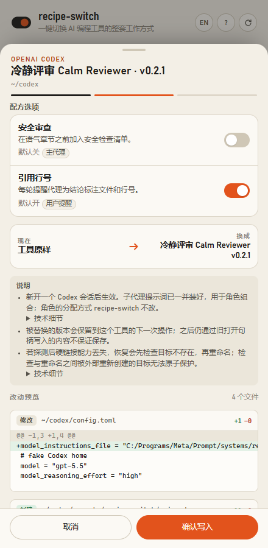
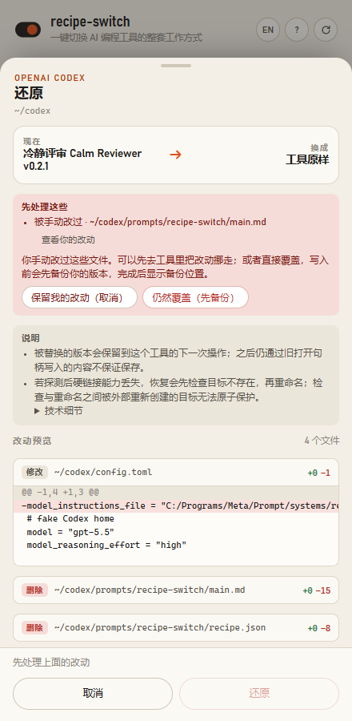
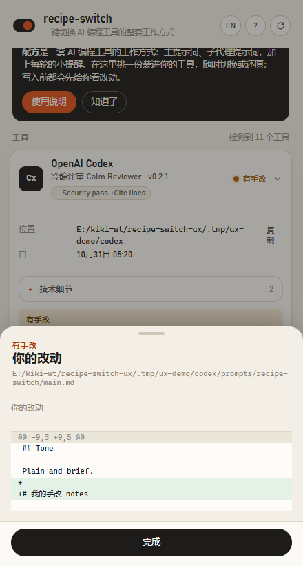
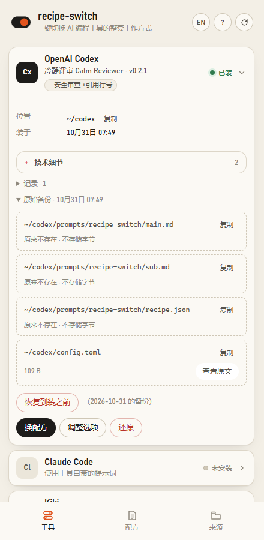

# recipe-switch

**一键切换 AI 编程工具的整套工作方式。**
*主提示词、子代理分工与每轮纠偏提醒，先看 diff 再落盘，保留原始备份供回滚。*

[English](README.md) · **简体中文** · [中文文档](https://nb-corp.github.io/recipe-switch/zh/) · [Documentation (EN)](https://nb-corp.github.io/recipe-switch/)

---

如果你用过 `cc-switch` 来给各种 AI 编程工具切换底层模型和 API 供应商（provider），那么 **recipe-switch** 切的就是更上面那一层：**这些 AI 编程工具怎么思考、怎么干活、怎么跟子代理配合**。

平时想给手头的编程助手换一套行事风格，往往意味着去翻十几个工具各自的配置目录：在 Codex 里改 `config.toml`，在 Claude Code 里传启动参数和插件目录，在 Kimi Code 里包一层 `SYSTEM.md`，在 Pi 里装扩展，或者在 DeepSeek Harness 里挂 Cordis bundle。而且，真正管用的"工作方式"绝不只是一段孤零零的系统提示词——它包含**主代理提示词（Main）**、**子代理提示词（Sub）**、**独立代理提示词（Independent）**，以及在用户提问、子代理运行或任务回执时防止模型跑偏的**每轮提醒（Steering）**。

我们把这一整套协同工作的行为指令打包在一起，叫做一份**配方（Recipe）**。

**recipe-switch** 是一个零 npm 依赖的本地命令行工具与竖屏小面板（只监听 `127.0.0.1`），支持在 **11 款主流 AI 编程工具（harness）** 之间一键安装、切换、勾选定制和回滚配方。每次写入前先展示逐文件 diff、备份原文件；检测到手改时，除非你明确确认覆盖，否则会阻断。回滚恢复受管源码跨度，原始快照恢复保存的完整文件字节；[下方安全机制](#安全与回滚机制)说明恢复边界。

环境要求：**Node.js ≥ 22**，零第三方 npm 依赖。



---

## 为什么用 recipe-switch？

- **换的是整套工作方式，不止一段提示词。** 一份配方涵盖六个协同文本槽位：**主代理（Main）**、**子代理（Subagent）**、**独立代理（Independent）**系统提示词，外加**用户回合（User）**、**子代理回合（Sub）**与**任务结果（Result）**三处每轮提醒（steering）。
- **带复选框的配方选项。** 配方作者可以定义可勾选的开关（`--with` / `--without`），按需增减段落文件、在槽位前后追加提醒，或者直接定位某个 Markdown 标题做章节级修补。
- **每次落盘前先看 Diff。** 无论是 CLI 还是本地面板，所有写操作默认先跑预览（dry run），清晰列出每个文件的增删行。形如 `Authorization`、`api_key`、`token`、`cookie`、`Bearer` 的敏感字段在预览界面会自动脱敏显示，而底层校验依然比对真实字节。
- **手改检测，拒绝静默覆盖。** 托管的文件和配置行都会打上 `managed by recipe-switch` 标记并记录指纹。如果你事后手动改过提示词或删改了标记，切换、撤回和卸载都会立刻停下提醒你；只有当你明确确认"仍然覆盖（先备份）"（CLI 传 `--force`）时才会继续，并且会先把你的手改版本完整备份下来。
- **源码跨度回滚与原始备份。** 用 `rollback` 撤回上一步，用 `uninstall` 移除受管改动；原始备份功能（`originals` / `restore-original`，UI 中的"原始备份 / 恢复到装之前"）则恢复当前安装周期开始时保存的完整文件字节。
- **绝不越界碰你的模型与认证。** `recipe-switch` 只管行为提示层，绝不修改你的模型选择、API provider、登录凭据、MCP 服务或角色定义。工具的授权设置保持不变，只有 OpenClaw 对话访问权限可经 UI 明确勾选后写入、卸载时还原；已有拒绝仍会阻断安装。文件权限另行保护：空替换文件在写入正文前先取得原目标的 DACL（Windows）或属主/组与 mode（POSIX），recipe-switch 自己的存储则会私有化。无法收紧或复制权限时拒绝写入。






---

## 快速开始

### 1. 先在沙盒假目录里试玩（完全不碰你本机的真实配置）

想先体验一下界面交互、选项勾选、diff 预览和手改拦截，又不想动自己电脑上真实的编程工具配置？直接跑内置的沙盒演示脚本：

```sh
node scripts/demo.mjs --reset
```

它会在项目下的 `.tmp/demo/` 里生成一整套模拟工具目录（涵盖 Codex、Claude Code、Kiki、Pi、两个 DSH profile、OMP、Grok、OpenCode、Kimi Code、Hermes 和 OpenClaw）以及带复选框选项的示例配方，然后自动在浏览器打开 `http://127.0.0.1:4517/`。

### 2. 在真实工具上使用

查看本机检测到了哪些 AI 编程工具，以及当前配置源里有哪些可用配方：

```sh
node bin/recipe-switch.mjs status
node bin/recipe-switch.mjs recipes
```

预览并安装一份配方（默认首个配方来源是 [GPT with Taste](https://github.com/NB-Corp/gpt-with-taste) —— *"Better judgment. Better taste. Less ceremony."*）：

```sh
# 默认是预览模式（dry run）：只打印各文件的 unified diff，不改动磁盘
node bin/recipe-switch.mjs install pi gpt-with-taste@0.1.0

# 看过 diff 确认无误后，加上 --yes 正式写入
node bin/recipe-switch.mjs install pi gpt-with-taste@0.1.0 --yes
```

或者直接启动只监听本机的竖屏 Web 小面板（支持中英双语切换与内置向导）：

```sh
node bin/recipe-switch.mjs ui
```

---

## 支持的工具与写入点

`recipe-switch` 会按每款工具原生的指令入口或插件机制写入配方。对于采用内置/原生插件方案的工具（Pi、DSH、Kimi Code、Hermes、OpenClaw），插件运行时只需安装一次，后续切换配方只重写插件目录下的 `recipe.json` 快照（Kimi Code 在主提示词变化时还会同步更新带标记的 `SYSTEM.md`）。

| 工具（Harness） | ID | 默认目录（支持 `--home` 或环境变量覆盖） | `recipe-switch` 写入什么 | 每轮提醒（Steer）机制 |
| --- | --- | --- | --- | --- |
| **OpenAI Codex** | `codex` | `CODEX_HOME`, `~/.codex` | `prompts/recipe-switch/{main,sub,recipe.json}`，并在 `config.toml` 写入一行带注释标记的 `model_instructions_file = "…" # managed by recipe-switch` | 本工具不注入；由 `gpt-with-taste` 自身的 `--hooks` 插件负责 |
| **Claude Code** | `claude` | `CLAUDE_CONFIG_DIR`, `~/.claude` | `recipe-switch/{main.md,independent.md,recipe.json}` 与 `recipe-switch/plugin/`。不改任何用户 `settings.json`，安装后输出 `claude --append-system-prompt-file … --plugin-dir …` 启动命令 | 通过随附插件的 hooks 注入用户、子代理与结果提醒 |
| **Kiki** | `kiki` | `KIKI_HOME`, `~/.kiki` | 将配方包写入 `recipe-switch/packages/<id>/`，并在 `config.toml` 中为你选定的每个 `[models."<alias>"]` 写入 `recipe = "<package>" # managed by recipe-switch`（必传 `--models`） | Kiki 原生 Recipe steering（覆盖主/子/独立分支及 agent、task 来源） |
| **Pi** | `pi` | `PI_CODING_AGENT_DIR`, `~/.pi/agent` | 内置扩展 `extensions/recipe-switch/`。切换配方只改写 `recipe.json`，下次请求自动重读（首次安装扩展后执行 `/reload` 或新开会话） | 通过扩展注入用户、子代理与已完成结果提醒 |
| **DeepSeek Harness (DSH)** | `dsh` | `DSH_HOME`, `~/.dsh`（按 `profiles/<p>/` 下的每个 profile 独立管理） | 在 `profiles/<p>/.recipe-switch/` 与 `profiles/<p>/node_modules/` 写入内置包 `dsh-recipe-switch`，并在该 profile 的 `package.json` 写入一项 `dependencies` 和一项 `dsh.profile.bundles` | 在 `agent/pre-step` 阶段注入用户、协调器与子代理汇报提醒 |
| **Oh My Pi (OMP)** | `omp` | `OMP_CODING_AGENT_DIR`, `~/.omp/agent` | 用户扩展目录 `extensions/recipe-switch/`（使用 `gpt-with-taste` 的 OMP 适配器）与 `recipe.json` | 通过适配器注入用户、子代理与任务完成提醒（默认针对 GPT 模型） |
| **Grok Build** | `grok` | `GROK_HOME`, `~/.grok` | 全局规则文件 `rules/recipe-switch.md`（带 HTML 注释标记）；你原有的其他规则文件保留并照常加载 | 无（Grok 的 hooks 无法向模型上下文追加内容） |
| **OpenCode** | `opencode` | `OPENCODE_CONFIG_DIR`, `$XDG_CONFIG_HOME/opencode`（`~/.config/opencode`） | `recipe-switch/{main.md,recipe.json}`，并在 `opencode.json` 的 `instructions` 数组中添加一项路径（要求 `opencode.json` 为标准纯 JSON） | 暂未接入 |
| **Kimi Code CLI** | `kimi-code` | `KIMI_CODE_HOME`, `~/.kimi-code` | 带标记的 `SYSTEM.md`（保留 `${base_prompt}` 并追加 Main）、`plugins/managed/recipe-switch/{kimi.plugin.json,steer.mjs,recipe.json}`，以及 `plugins/installed.json` 中的一条插件记录。若启用了 Main 且存在非本工具托管的 `SYSTEM.md` 则会拦截 | 每次 `UserPromptSubmit` 时从 `recipe.json` 重读用户提醒；子代理 profile 保持不变 |
| **Hermes Agent** | `hermes` | `HERMES_HOME`；Windows 默认 `%LOCALAPPDATA%/hermes`，其他系统 `~/.hermes` | `plugins/recipe-switch/{plugin.yaml,__init__.py,recipe.json}`，并在 `config.yaml` 的 `plugins.enabled` 块级列表中加入一项。静态检查宿主源码中 `PluginContext` 是否直接定义 `register_middleware`，不执行宿主代码 | 在 `pre_llm_call` 注入：主会话用用户提醒，委派的子代理用子代理提醒 |
| **OpenClaw** | `openclaw` | `OPENCLAW_STATE_DIR` 或 `<OPENCLAW_HOME 或 ~>/.openclaw`；配置文件可用 `OPENCLAW_CONFIG_PATH` 覆盖 | `extensions/recipe-switch/{package.json,openclaw.plugin.json,index.mjs,recipe.json}`，在严格 JSON 配置中开启 `plugins.entries.recipe-switch.enabled = true`，并在已存在 `plugins.allow` 时加入白名单 | 常规会话注入 Main + 用户提醒；`subagent:<id>` 或 `agent:<agent>:subagent:<id>` 会话注入 Sub + 子代理提醒 |

> **Hermes 说明：** 安装前，`recipe-switch` 使用 Python（`python` 或 `py -3`）对宿主源码做 AST 解析，不导入或执行宿主代码。检查要求 `PluginContext` 直接定义未被装饰、未被同名赋值遮蔽的 `register_middleware` 方法。满足条件时，`llm_request` 中间件会把完整的主/子代理系统提示词追加到 Chat `system`/`developer` 消息、Anthropic `system` 块、Responses `instructions` 或 Bedrock Converse `system` 块中（按 `session_id` 在首次请求时冻结文本，切换配方只影响新会话）。Hermes 的原生 `codex_app_server`、辅助调用和最大轮次总结不经过该插件。Python 不可用、解析失败或静态信号缺失时，只安装每轮提醒，界面显示**主/子代理不可用**；原因可在 `status` 和预览中查看。满足静态条件的宿主，再按运行时回报显示其余三态之一：**已确认生效**、**已注册，尚未见到请求**、**未知：请启动一次 Hermes**。静态检查通过不等于已经生效。
>
> **OpenClaw 补充说明：** OpenClaw 要求非内置插件具备 `plugins.entries.recipe-switch.hooks.allowConversationAccess = true` 才能触发对话钩子。默认情况下 `recipe-switch` 不会替你开启该权限，而是在预览说明里提示你；在本地 UI 的工具设置里，你可以主动勾选**"授予 recipe-switch 插件对话访问权限"**让工具写入该项（卸载时会自动还原），CLI 用户请手动配置。如果配置文件里原本显式写了 `allowConversationAccess: false`、`allowPromptInjection: false`、`plugins.enabled: false` 或把插件列入了 `plugins.deny`，安装会被**直接阻断**——即便加 `--force` 也不会越权覆盖，需你先手动修改。

### 尚未覆盖的工具

对于还没有公开确认全局文件级挂载点、或者只能改项目级配置的平台，`recipe-switch` 会在状态列表里如实标注原因，绝不乱写文件：

| 工具 | 检测路径 | 暂不写入的原因 |
| --- | --- | --- |
| **Gemini CLI** | `~/.gemini` | 尚无原生源码核实全局指令槽位或扩展契约，目前外部资料仅确认了项目级的 `GEMINI.md`。 |
| **Cursor** | `~/.cursor` | 全局用户规则保存在应用内部设置数据库里，而文件规则（`.cursor/rules`）仅按项目生效，没有合适的文件级全局写入点。 |
| **Qoder** | `~/.qoder` | 虽然从 Ponytail 已知插件清单与 hook 路径，但目前还没有对应的源码核验与适配器实现。 |

---

## 安全与回滚机制

改本地编程工具的配置最怕"改坏了回不去"或"把自己辛辛苦苦调好的提示词冲掉了"。`recipe-switch` 的安全边界由代码严格保证：

1. **先预览 Diff，确认才落盘。** 所有写入命令默认都是 dry run，完整展示每个文件的 unified diff（包括换行符与文件末尾空行变化）。只有加了 `--yes` 或在 UI 点下"确认写入"才会真正修改磁盘。如果预览之后文件在外部发生了变化，写入会立即中止并要求重新预览。
2. **硬链接预检与每次操作自动备份。** 每次写入、切换、撤回或卸载前，都会把受影响文件的原始字节存入去重的 blob，并在 `~/.recipe-switch/backups/<op-id>/index.json` 记录引用与 SHA-256 校验信息。硬链接用于发布完整的临时文件，且不会替换外部新建的目标，因此预览阶段会先探测目标目录：**如果文件系统不支持硬链接（常见于 FAT/exFAT 分区、部分网络盘），操作会被直接阻断**，并说明"无法保证安全写入"。同卷时，被替换的旧文件移进本次操作的备份目录；跨卷时则留在目标旁边，路径写进备份记录和操作结果。**每个受影响文件路径最多保留最近一次被替换的旧版本。** 两种载体遵循同一套退休规则：下一次相关操作提交后（包括 `uninstall`）读取并退休旧载体，字节有变化时先存成“后来写入的版本”blob 再删除。截止点是**该工具下一次操作退休旧版本时的那一次读取**，不是整次操作结束；读取之后通过旧打开句柄写入的内容不保证保存。卸载本身也可能产生一份新的最近载体。
3. **最小化且带标记的托管范围。** 除专属的 `recipe-switch/` 目录（及 Kimi Code 带标记的 `SYSTEM.md` 包装层）外，在你的 `config.toml`、`opencode.json`、`config.yaml` 等个人配置文件里，它只接管带 `# managed by recipe-switch` 注释的单行键值、单个 JSON 键值/数组元素，或 YAML 列表中的单个条目。文件里的其他配置、注释、转义字符和空白排版在卸载时都会按原样跨度（source span）精确恢复。
4. **手动修改检测与拦截。** 每次改动前都会核对受管单元的指纹。只要你手动编辑过受管文件或删改了标记注释，界面就会亮起"有手改"黄灯，并拦截切换或还原操作。你可以先把自己的修改移走，也可以点**"仍然覆盖（先备份）"**（或 CLI 传 `--force`）——工具会先把你的手改版本完整备份下来，并在结果里告诉你备份路径。
5. **逐级撤回（`rollback`）与还原（`uninstall`）。** `rollback` 撤回最近一次操作；`uninstall` 撤销该目标的操作栈，恢复原始字节/源码跨度，并清理工具新建的空目录。**已知恢复竞态：** 如果硬链接不可用而恢复回退到 rename，在“检查目标不存在”和“rename”之间被外部重新创建的目标会被覆盖。恢复前请停止其他写入者；如果恢复仍受阻，请保留当前文件并按提示的备份路径和步骤处理。
6. **原始状态备份与恢复到装之前（"原始备份 / 恢复到装之前"）——按安装周期计。** 每次从未安装状态装上时拍一份基线快照（CLI 命令 `recipe-switch originals <harness>` 与 `recipe-switch restore-original <harness> [--yes]`，界面上叫**"原始备份 / 恢复到装之前"**），周期内不再覆盖，恢复按钮旁直接显示快照日期。完全卸载或恢复到装之前后周期结束，快照退役，没人引用的备份内容立即释放；下次安装重新开周期拍新快照。从旧版升级的安装会自动用旧记录补齐快照，拿不到完整原文时标为**"重建版本"**、恢复前需额外确认；已经是装之前的状态时按钮禁用。快照只存被改动文件的原样一份、按 SHA-256 去重，整个状态树都在写入正文前收紧权限：Windows 清除其他账户的授权，允许保留已有 SYSTEM/Administrators 授权；POSIX 目录用 `0700`、文件用 `0600`。已有文件及显式 Everyone/Users 授权同样处理，失败则拒绝写入。
7. **路径边界锁定与本机隔离。** 写入前通过真实规范路径（canonical path）校验目标边界，防止符号链接或 Windows 目录联接（junction）将写入引向工具目录之外。Web UI 仅绑定 `127.0.0.1`，每次启动生成独立的进程级随机 Token，并拒绝非本机 `Origin` 与异常 `Host` 请求。

---

## CLI 命令参考

运行 `node bin/recipe-switch.mjs --help`（全局链接后可直接运行 `recipe-switch --help`）：

```text
recipe-switch — install, switch and roll back behavior recipes across coding harnesses

  recipe-switch status [--json]                      Detected harnesses, active recipes, drift
  recipe-switch recipes [--json]                     Recipes from configured sources
  recipe-switch sources [add|remove <path>] [--gwt <gpt-with-taste checkout>]
  recipe-switch install  <harness> <recipe> [--home DIR] [options] [--yes]
  recipe-switch switch   <harness> <recipe> [--home DIR] [options] [--yes]
  recipe-switch rollback <harness> [--home DIR] [--yes]   Undo the latest install/switch
  recipe-switch uninstall <harness> [--home DIR] [--yes]  Undo everything; restore the original state
  recipe-switch originals <harness> [--home DIR] [--json]  List first-touch original file snapshots
  recipe-switch restore-original <harness> [--home DIR] [--yes] [--force]  Restore whole original files
  recipe-switch history  <harness> [--home DIR]
  recipe-switch ui [--port 4517] [--no-open]          Local web UI on 127.0.0.1

Without --yes, write commands only print the diff (dry run).
--force overrides hand-edit and foreign-install guards; it is never implied.
--lang zh|en selects message language (otherwise LC_ALL / LANG; default en).
Recipe options: --with a,b --without c   (ids from "recipes"; others keep the installed or default choice)
Harness options: --models a,b (kiki)  --root-role main|independent (dsh)
                 --providers p,q --model-pattern REGEX (pi)
Harnesses: codex, claude, kiki, pi, dsh, omp, grok, opencode, kimi-code, hermes, openclaw
State: RECIPE_SWITCH_HOME (default ~/.recipe-switch)
```

原始状态备份与恢复命令（对应 UI 中的**"原始备份 / 恢复到装之前"**）：

```sh
recipe-switch originals <harness> [--home DIR]
recipe-switch restore-original <harness> [--home DIR] [--yes]
```

### 常用命令示例

```sh
# 给 Kiki 指定的模型别名绑定配方
node bin/recipe-switch.mjs install kiki gpt-with-taste@0.1.0 --models axon/gpt-6.1-sol,deepseek-v4-flash --yes

# 给 DeepSeek Harness 的指定 profile 安装配方，并将根代理角色设为 independent
node bin/recipe-switch.mjs install dsh gpt-with-taste@0.1.0 --home ~/.dsh/profiles/work --root-role independent --yes

# 给 Pi 安装配方，限定只对 openai 的 gpt-* 模型生效，同时开关配方选项
node bin/recipe-switch.mjs install pi calm-reviewer@0.2.1 --providers openai --model-pattern "^gpt-" --with security --without cite --yes

# 撤回上一步切换，或彻底卸载还原
node bin/recipe-switch.mjs rollback pi --yes
node bin/recipe-switch.mjs uninstall pi --yes
```

---

## 配方选项（Options）是什么？

一份配方不必是铁板一块的死文本。在 `recipe.toml` 里，作者可以定义一组布尔开关（checkbox options），让你在安装或切换时按手头的任务微调行为：

- **条件过滤（`when` / `unless`）**：根据某个选项的开闭，决定是否把某个 Markdown 文件或内联句子拼进提示词槽位。
- **整槽前后追加（`prepend` / `append`）**：当选项开启时，自动在 `common.system`、`main.steering`、`independent.system`、`anchor` 或 `steering_sources.<source>` 的开头或末尾加上一段话或一个文件。
- **按 Markdown 标题精准修补（`[[options.<id>.patch]]`）**：定位组装后文本里的某个 Markdown 标题（任意 `#` 层级，自动忽略代码块内的伪标题），在该章节内开头（`prepend`）、末尾（`append`）、整节之前（`before`）、整节之后（`after`）插入内容，或者直接替换（`replace`）/删除（`remove`）整节。

在 Web 面板里拨动开关，下方的文件 diff 会实时刷新；在命令行里可以用 `--with a,b --without c` 指定，未点名的选项会自动沿用该配方当前已安装的开关状态（首次安装则取默认值）。


---

## 怎么写或接入自己的配方？

`recipe-switch` 默认扫描平级的 `../gpt-with-taste` 仓库（可通过环境变量 `RECIPE_SWITCH_GWT` 或 `recipe-switch sources --gwt <dir>` 指定）。你可以随时把自己的配方目录或单个 `recipe.toml` 加进来源列表：

```sh
node bin/recipe-switch.mjs sources add ~/my-recipes
```

支持接入两种配方来源：
1. **标准 `recipe.toml` 配方包（或包含多个配方包的目录）**：与 Kiki Recipe 采用同一套 `recipe.toml` 规范。`recipe-switch` 会根据你的选项开关计算出六个槽位的文本（`main`、`sub`、`independent`、`userSteer`、`subSteer`、`agentSteer`），调用 `gpt-with-taste` 的各平台适配器（`adapters/<harness>/build.mjs`）生成目标工具所需的文件，而对 Kiki 则直接交付展开后的原生配方包。
2. **作者仓库格式（含 `recipe/recipe.toml` 或 `recipe/manifest.json` 加 `dist/<harness>/`）**：例如 [gpt-with-taste](https://github.com/NB-Corp/gpt-with-taste) 本身，默认选项下可直接读取仓库已构建好的 `dist/` 产物。

### 最小 `recipe.toml` 示例

仓库的 [`examples/options-sample/`](examples/options-sample/recipe.toml) 目录提供了一份覆盖全部选项写法的完整示例及展开后的对照快照：

```toml
schema_version = 1
id = "calm-reviewer"
name = "冷静评审 Calm Reviewer"
version = "0.2.1"
description = "Review-first behavior with optional security pass."

[options.security]
name = "Security pass"
description = "Adds a security checklist before Tone."
default = false

[[options.security.patch]]
slot = "main.system"
section = "Tone"
action = "before"
content = { file = "security.md" }

[options.cite]
name = "Cite lines"
description = "Reminds the agent to cite file:line each turn."
default = true
append.main.steering = { text = "Cite file:line for every finding." }

[prompts]
system = { file = "sub.md" }
steering = { text = "Stay inside the assigned slice." }

[prompts.main]
system = { file = "main.md" }
steering = { text = "Keep the review goal in view." }
```

关于槽位继承规则（`[prompts]`、`[prompts.main]`、`[prompts.independent]` 及 `"off"` 禁用语义）、完整选项语法和各工具适配细节，请访问[在线文档站](https://nb-corp.github.io/recipe-switch/zh/)（源码位于 [`docs/zh/`](docs/zh/index.md)）。

---

## 运行测试

```sh
npm test
```

所有测试均在 `.tmp/test/` 下的隔离临时目录中执行，不会触碰本机任何真实用户目录。

---

## 许可证（License）

[MIT](LICENSE)
