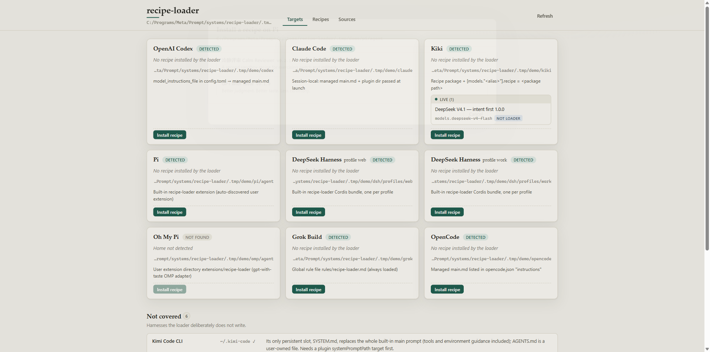
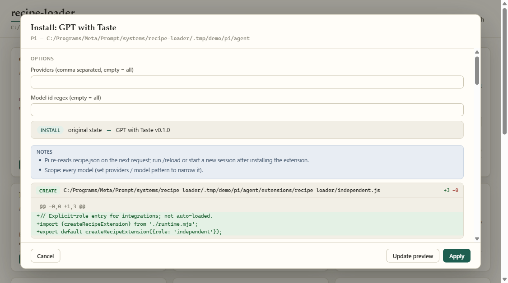
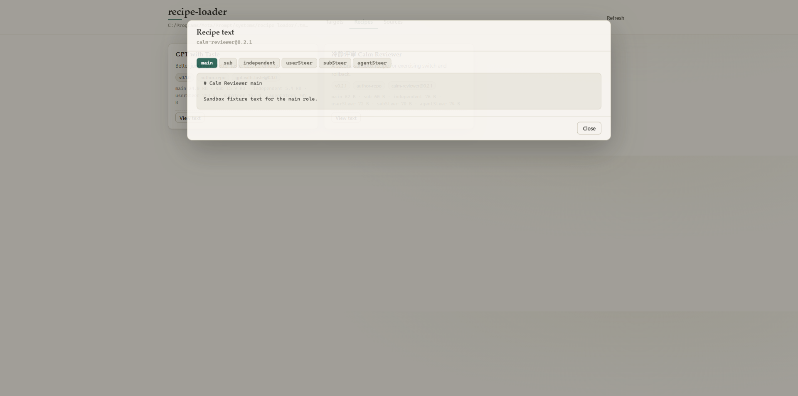

# Installation & Quick Start

[Home](index.md) · **Getting Started** · [Harnesses](harnesses.md) · [Safety & Rollback](safety.md) · [Recipes & Options](recipes.md) · [FAQ](faq.md) · [简体中文](zh/getting-started.md)

---

## Prerequisites

- **Node.js ≥ 22** (uses built-in ES modules and native APIs; **zero npm dependencies**).
- A checkout of [gpt-with-taste](https://github.com/NB-Corp/gpt-with-taste) alongside `recipe-switch` (`../gpt-with-taste` by default, or pointed to via `RECIPE_SWITCH_GWT` / `recipe-switch sources --gwt <dir>`). `gpt-with-taste` supplies both the default behavior recipe and the harness build adapters.

Clone both repositories side by side:

```sh
git clone https://github.com/NB-Corp/gpt-with-taste.git
git clone https://github.com/NB-Corp/recipe-switch.git
cd recipe-switch
```

*(Optional)* Link the `recipe-switch` binary globally on your machine:

```sh
npm link
```

---

## 1. Try the Sandbox Demo First (Zero Risk)

Before touching any real configuration in your home directory, you can launch `recipe-switch` against a disposable sandbox:

```sh
node scripts/demo.mjs --reset
```

What this does:
1. Creates fake harness homes inside `.tmp/demo/` for Codex, Claude Code, Kiki, Pi, two DeepSeek Harness profiles (`web` and `work`), OMP, Grok, OpenCode, Kimi Code, Hermes, and OpenClaw.
2. Creates a second sample recipe (`calm-reviewer@0.2.1`) with checkbox options (`security` section patch and `cite` steering append) alongside `gpt-with-taste`.
3. Starts the local web server on `http://127.0.0.1:4517/` with all environment variables pointed at `.tmp/demo/`.

Options for `scripts/demo.mjs`:
- `--reset` — recreate `.tmp/demo/` from scratch.
- `--dir <DIR>` — use a custom sandbox directory.
- `--port <N>` — change the port (default `4517`).
- `--no-open` — start the server without opening a browser tab automatically.



---

## 2. Inspect Your Real Tools & Recipes

Run `status` to see which coding tools are installed on your machine, whether a recipe is active, whether any manual edits ("drift") were detected, and whether any foreign installers block takeover:

```sh
node bin/recipe-switch.mjs status
```

Pass `--json` if you want machine-readable output:

```sh
node bin/recipe-switch.mjs status --json
```

List all available recipes and their checkbox options from your configured sources:

```sh
node bin/recipe-switch.mjs recipes
```

---

## 3. Preview and Install a Recipe (CLI)

Every write command (`install`, `switch`, `rollback`, `uninstall`, `restore-original`) runs as a **dry run by default** when `--yes` is omitted:

```sh
# 1. Dry run: prints every file action (CREATE / MODIFY / DELETE) and unified diff
node bin/recipe-switch.mjs install pi gpt-with-taste@0.1.0

# 2. Apply: writes the files and saves a backup under ~/.recipe-switch/backups/
node bin/recipe-switch.mjs install pi gpt-with-taste@0.1.0 --yes
```



### Passing Recipe Options & Harness Options

Toggle recipe checkboxes with `--with` and `--without`, and pass tool-specific flags where needed:

```sh
# Kiki requires --models (comma-separated model aliases from ~/.kiki/config.toml)
node bin/recipe-switch.mjs install kiki gpt-with-taste@0.1.0 --models axon/gpt-6.1-sol --yes

# DeepSeek Harness has one target per profile; pass --home when multiple profiles exist
node bin/recipe-switch.mjs install dsh gpt-with-taste@0.1.0 --home ~/.dsh/profiles/web --root-role main --yes

# Pi supports optional provider and model-id regex filters, plus recipe options
node bin/recipe-switch.mjs switch pi calm-reviewer@0.2.1 --providers openai --model-pattern "^gpt-" --with security --without cite --yes
```

---

## 4. Use the Local Web UI

Launch the portrait control panel on `127.0.0.1`:

```sh
node bin/recipe-switch.mjs ui
```

- **Tools tab**: Expand any detected tool to inspect its home path, write mechanism, active steering, and operation history. Click **Install a recipe** or **Switch recipe** to open the interactive bottom sheet.
- **Live Diff Preview**: Flip recipe option switches or change tool settings and watch the unified diff update immediately below.
- **Recipes tab**: Inspect every loaded recipe, see which tools currently use it, and click any of the six text slots (**Main**, **Subagent**, **Independent**, **User reminder**, **Sub reminder**, **Result reminder**) to read the full assembled Markdown text as options are toggled.
- **Sources tab**: Add or remove local recipe directories or `recipe.toml` files, and configure your `gpt-with-taste` checkout path.
- **Language & Guide**: Click `EN` / `中` in the top bar to switch between English and Chinese, or click `?` to open the 5-step visual walkthrough.



---

## 5. Roll Back or Restore Original State

```sh
# Undo the most recent install or switch on a harness
node bin/recipe-switch.mjs rollback pi --yes

# Undo the entire history stack and restore the tool to its pre-recipe-switch state
node bin/recipe-switch.mjs uninstall pi --yes

# View operation history and backup directories
node bin/recipe-switch.mjs history pi

# Inspect or restore the pre-install original state backup ("原始备份 / 恢复到装之前")
node bin/recipe-switch.mjs originals pi
node bin/recipe-switch.mjs restore-original pi --yes
```

Next: see [Supported Harnesses & Write Points](harnesses.md) for the exact files edited in each tool.
