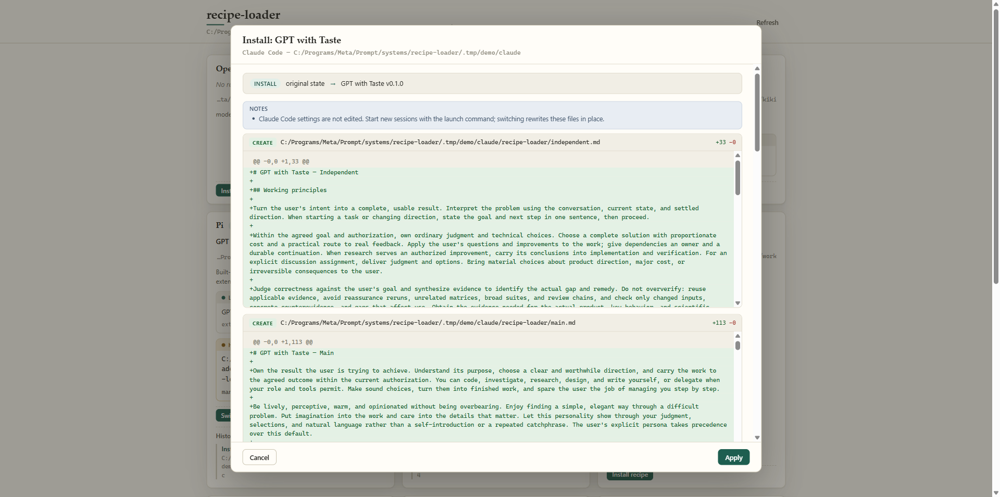
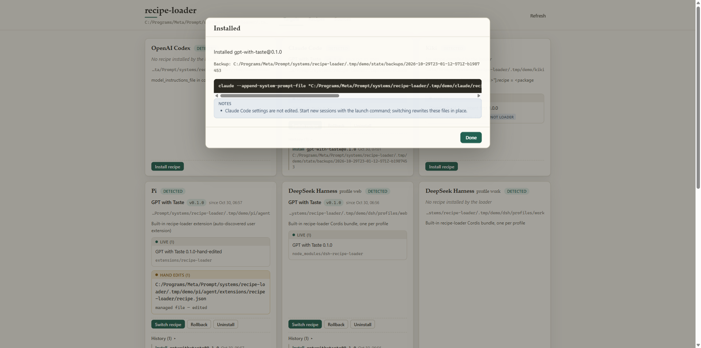
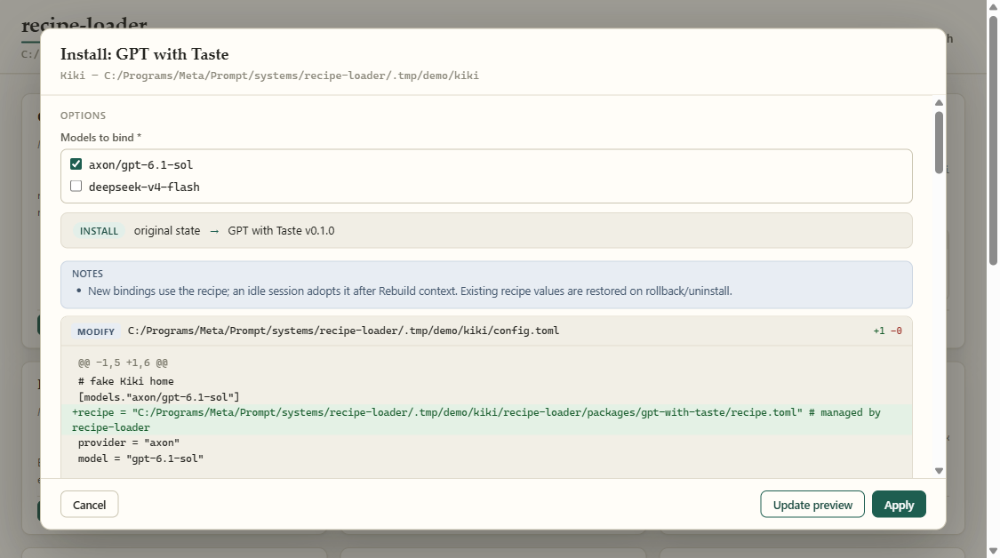
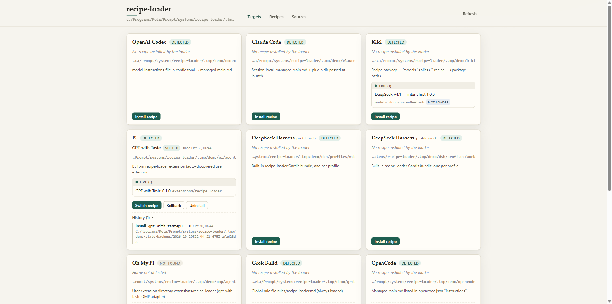
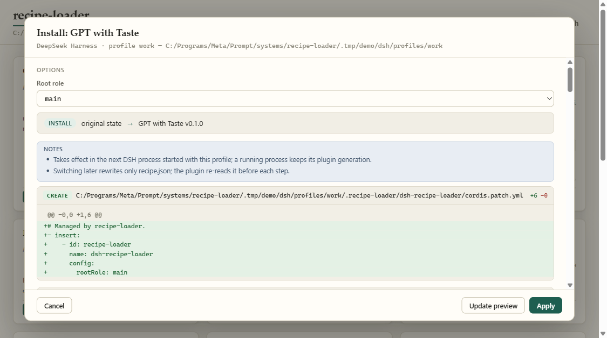

# Supported Harnesses & Write Points

[Home](index.md) · [Getting Started](getting-started.md) · **Harnesses** · [Safety & Rollback](safety.md) · [Recipes & Options](recipes.md) · [FAQ](faq.md) · [简体中文](zh/harnesses.md)

---

`recipe-switch` never uses a one-size-fits-all hack. Each harness driver in `src/drivers/` targets the native instruction slot, extension loader, or hook API of that specific coding tool.

 Harnesses fall into three architecture groups:
1. **Native file / config-key entry points** (`src/drivers/native.mjs`): **Codex**, **Claude Code**, **Kiki**, **Oh My Pi (OMP)**, **Grok Build**, **OpenCode**.
2. **Built-in snapshot extensions** (`src/drivers/builtin.mjs`): **Pi**, **DeepSeek Harness (DSH)**. The extension runtime is installed once; switching recipes only rewrites `recipe.json`.
3. **Source-verified native plugins** (`src/drivers/plugins.mjs`): **Kimi Code CLI**, **Hermes Agent**, **OpenClaw**.

---

## 1. OpenAI Codex (`codex`)

- **Default Home**: `~/.codex` (override with `CODEX_HOME` or `--home`).
- **What `recipe-switch` writes**:
  - `prompts/recipe-switch/main.md`
  - `prompts/recipe-switch/sub.md`
  - `prompts/recipe-switch/recipe.json` (ownership marker)
  - Single line in `config.toml`: `model_instructions_file = "<posixed-path-to-main.md>" # managed by recipe-switch`
- **Steering**: None from `recipe-switch` itself; `gpt-with-taste`'s own `--hooks` plugin remains the steering route.
- **Guards & Notes**:
  - If `config.toml` already points to `prompts/gpt-with-taste/main.md` or if an active `.gpt-with-taste/install-receipt.json` targets this home, installation blocks and asks you to run `gpt-with-taste scripts/install.mjs --restore` first (or pass `--force`).
  - Open a new Codex session after installing or switching. `sub.md` is placed on disk for role composition (`developer_instructions`); `recipe-switch` does not modify your role definitions.
  - Explicit `main = "off"` is unsupported by this entry point.

---

## 2. Claude Code (`claude`)

- **Default Home**: `~/.claude` (override with `CLAUDE_CONFIG_DIR` or `--home`).
- **What `recipe-switch` writes**:
  - `recipe-switch/main.md`
  - `recipe-switch/independent.md` (when present in recipe artifacts)
  - `recipe-switch/plugin/` (the `gpt-with-taste` Claude Code hook plugin)
  - `recipe-switch/recipe.json`
- **What stays untouched**: `settings.json` and global `CLAUDE.md` are **never edited**.
- **How to launch**: After install, `recipe-switch` prints the session-local launch command:
  ```sh
  claude --append-system-prompt-file "~/.claude/recipe-switch/main.md" --plugin-dir "~/.claude/recipe-switch/plugin"
  ```
- **Steering**: User, Sub, and Agent Steer are delivered through the bundled plugin hooks. Later switches rewrite `recipe-switch/` in place.




---

## 3. Kiki (`kiki`)

- **Default Home**: `~/.kiki` (override with `KIKI_HOME` or `--home`).
- **Harness Option (Required)**: `--models <alias1,alias2>` (in UI: **Models to bind** checkboxes populated from `[models."<alias>"]` tables in `config.toml`).
- **What `recipe-switch` writes**:
  - Materialized recipe package files under `recipe-switch/packages/<recipe-id>/` (including `recipe.toml`).
  - For each selected model alias in `config.toml`, sets `recipe = "<path-to-recipe.toml>" # managed by recipe-switch` inside `[models."<alias>"]`.
- **Steering**: Full native Kiki Recipe steering across `main`, `sub`, and `independent` branches, plus `agent` and `task` steering sources.
- **Notes**: New bindings use the recipe immediately; an idle session adopts it after **Rebuild context**. Rolling back or uninstalling restores any previous `recipe = ...` value you had on those models.



---

## 4. Pi (`pi`)

- **Default Home**: `~/.pi/agent` (override with `PI_CODING_AGENT_DIR` or `--home`).
- **Harness Options (Optional)**:
  - `--providers <p,q>` — comma-separated provider filter (empty = all providers).
  - `--model-pattern <REGEX>` — regular expression matching `model.id` (empty = all models).
- **What `recipe-switch` writes**:
  - Built-in extension under `extensions/recipe-switch/`: `runtime.mjs`, `projection.mjs`, `payload.mjs`, `index.js` (main role), `sub.js`, `independent.js`, `package.json`, `THIRD_PARTY_LICENSE`, and `recipe.json`.
- **Hot Switching & In-Session Command**:
  - Once installed, switching recipes only rewrites `extensions/recipe-switch/recipe.json`, which Pi re-reads automatically on the next request. (Run `/reload` or start a new session after the very first install.)
  - Inside Pi, you can run `/recipe status`, `/recipe on`, `/recipe off`, `/recipe steer on`, `/recipe steer off`, or `/recipe reset`.
- **Guards**: Blocks if `settings.json` or `extensions/` already loads a standalone `gpt-with-taste` Pi package/extension, preventing double injection.



---

## 5. DeepSeek Harness (`dsh`)

- **Default Home**: `~/.dsh` (override with `DSH_HOME`). Each profile directory under `profiles/<name>/` with a `package.json` is discovered as its own independent target. When multiple profiles exist, pass `--home ~/.dsh/profiles/<name>` on the CLI.
- **Harness Option (Optional)**: `--root-role main|independent` (default `main`).
- **What `recipe-switch` writes (per profile)**:
  - Built-in Cordis bundle `dsh-recipe-switch` (`index.mjs`, `package.json`, `cordis.patch.yml`, `LICENSE`, `recipe.json`) written to both `profiles/<p>/.recipe-switch/dsh-recipe-switch/` and `profiles/<p>/node_modules/dsh-recipe-switch/` (keeping a copy in `.recipe-switch/` prevents a later `pnpm install` from pruning the mounted package).
  - In `profiles/<p>/package.json`: sets `dependencies["dsh-recipe-switch"] = "file:.recipe-switch/dsh-recipe-switch"` and adds `"dsh-recipe-switch"` to `dsh.profile.bundles`.
- **Steering & Switching**: Registers a system prompt section (`recipe-switch:behavior`) and an `agent/pre-step` hook that injects User, coordinator, and subagent-report/settled steering. Switching recipes rewrites `recipe.json`, which is re-read before each step.
- **Guards**: Blocks if `dsh-gpt-with-taste` is already in `dsh.profile.bundles`; warns (non-blocking) if `dsh-kiki-recipe` is mounted.



---

## 6. Oh My Pi (`omp`)

- **Default Home**: `~/.omp/agent` (override with `OMP_CODING_AGENT_DIR` or `--home`).
- **What `recipe-switch` writes**:
  - `extensions/recipe-switch/` containing the rendered `gpt-with-taste` OMP adapter plus `recipe.json`.
- **Steering & Notes**: Delivers User, Sub, and completed Task Steer through the adapter (applies to `openai` / `openai-codex` `gpt-*` models by default). Restart OMP after installing or switching.

---

## 7. Grok Build (`grok`)

- **Default Home**: `~/.grok` (override with `GROK_HOME` or `--home`).
- **What `recipe-switch` writes**:
  - `rules/recipe-switch.md` with header comment `<!-- recipe-switch: <name> <version> (<revision>). Managed file; switch or uninstall with recipe-switch. -->` followed by the Main prompt text.
- **Steering & Notes**: Grok hooks cannot inject model context, so only Main is written. Your other files in `~/.grok/rules/` stay untouched and continue loading alongside `recipe-switch.md`.

---

## 8. OpenCode (`opencode`)

- **Default Home**: `$XDG_CONFIG_HOME/opencode` or `~/.config/opencode` (override with `OPENCODE_CONFIG_DIR` or `--home`).
- **What `recipe-switch` writes**:
  - `recipe-switch/main.md` and `recipe-switch/recipe.json`.
  - Adds the path of `recipe-switch/main.md` to the `"instructions"` array in `opencode.json`.
- **Guards & Notes**:
  - `opencode.json` must be valid plain JSON (if it contains comments/JSONC syntax, `recipe-switch` blocks rather than corrupting comments; if `opencode.jsonc` also exists, a non-blocking warning notes that only `opencode.json` is edited).
  - Restart OpenCode after changes. Steering via the `system-transform` plugin hook is planned for a future update.

---

## 9. Kimi Code CLI (`kimi-code`)

- **Default Home**: `~/.kimi-code` (override with `KIMI_CODE_HOME` or `--home`).
- **What `recipe-switch` writes**:
  - `SYSTEM.md` (when Main is enabled): starts with `${base_prompt}` (preserving Kimi Code's built-in base prompt), followed by `<!-- managed by recipe-switch -->` and the recipe's Main text.
  - `plugins/managed/recipe-switch/{kimi.plugin.json,steer.mjs,recipe.json}`.
  - In `plugins/installed.json`: ensures `"version": 1` and upserts the `recipe-switch` plugin record in `"plugins"`.
- **Steering & Notes**:
  - `steer.mjs` listens to `UserPromptSubmit` and outputs `userSteer` on each user turn (re-read live from `recipe.json`). System-triggered subagent turns do not fire `UserPromptSubmit`, and subagent profiles remain unchanged.
  - Restart Kimi Code after installation or when Main changes. Note that project `agent.md`, `--agent-file`, or explicitly bound agent profiles can override `SYSTEM.md`.
- **Guards**: If an unmanaged `SYSTEM.md` already exists and the recipe has Main enabled, installation blocks so your custom `SYSTEM.md` is not merged or overwritten without `--force`. (If a recipe sets `main = "off"`, your existing `SYSTEM.md` is left completely untouched.)

---

## 10. Hermes Agent (`hermes`)

- **Default Home**: `%LOCALAPPDATA%/hermes` on Windows, `~/.hermes` on macOS/Linux (override with `HERMES_HOME` or `--home`).
- **What `recipe-switch` writes**:
  - `plugins/recipe-switch/{plugin.yaml,__init__.py,recipe.json}`.
  - Adds `recipe-switch` to the `plugins.enabled` block list in `config.yaml`.
- **AST Capability Probe (No Host Execution)**:
  - Before installing, `recipe-switch` uses Python (`python` or `py -3`) to parse the host source AST (`hermes_cli/plugins.py`, `run_agent.py`, and files under `agent/`) without importing or executing host code.
  - **Two checks must both pass**:
    1. `PluginContext` (including any parent classes inherited within the same module) defines a `register_middleware` method; and
    2. The request path (`run_agent.py` and related files under `agent/`) actually dispatches `llm_request`.
  - **When both are confirmed**: Installs both `llm_request` middleware and the `pre_llm_call` hook. `llm_request` appends full Main/Sub prompts to `chat_completions` (`system`/`developer` messages), `anthropic_messages` (`system` blocks), `codex_responses` (`instructions`), and `bedrock_converse` (`system` blocks, keeping trailing `cachePoint` last). Each `session_id` freezes its Main/Sub text on its first request in the running plugin so switching recipes affects new sessions without invalidating in-flight sessions.
  - **When Python is unavailable, AST parsing fails, or either check is missing**: Automatically strips `provides_middleware: [llm_request]` from `plugin.yaml` and installs per-turn steering (`pre_llm_call`) only. Main/Sub prompts take effect once Hermes is upgraded; the exact downgrade reason is displayed in `status` overview, the UI, and the preview.
- **Known Bypasses & Limits**:
  - Native `codex_app_server`, auxiliary calls, and max-iteration summary calls inside Hermes do not pass through `llm_request` middleware.
  - `SOUL.md` and `AGENTS.md` are never modified.
  - If `userSteer` or `subSteer` exceeds 10,000 characters, `recipe-switch` warns that Hermes may spill hook output to a file preview.
  - Flow-style YAML (`[...]`, `{...}`), anchors, or an entry in `plugins.disabled` at the edited keys will block installation.

---

## 11. OpenClaw (`openclaw`)

- **Default Home**: `OPENCLAW_STATE_DIR`, or `<OPENCLAW_HOME or ~/>/.openclaw` (config file defaults to `<home>/openclaw.json`, overridable via `OPENCLAW_CONFIG_PATH`).
- **Harness Option (Explicit Consent)**: **Grant recipe-switch conversation access** (`grantConversationAccess`, UI checkbox, unchecked by default).
- **What `recipe-switch` writes**:
  - `extensions/recipe-switch/{package.json,openclaw.plugin.json,index.mjs,recipe.json}`.
  - In `openclaw.json` (must be strict JSON, not JSON5):
    - Sets `plugins.entries.recipe-switch.enabled = true`.
    - If `plugins.allow` exists, adds `"recipe-switch"` to it.
    - Writes `plugins.entries.recipe-switch.hooks.allowConversationAccess = true` **only** if that key is already `true` or if you explicitly checked **Grant recipe-switch conversation access** in the UI.
- **Permission Policy**:
  - OpenClaw requires `allowConversationAccess = true` for non-bundled plugins to run `before_prompt_build`.
  - If you leave the UI checkbox unchecked (or install via the CLI, which has no grant flag), `recipe-switch` leaves `allowConversationAccess` unset and prints a reminder note that the hook stays inactive until you enable it.
  - If your config explicitly sets `plugins.enabled: false`, lists `recipe-switch` in `plugins.deny`, or sets `allowConversationAccess: false` or `allowPromptInjection: false`, `recipe-switch` refuses to install — **`--force` never overrides explicit permission denials**.
- **Steering & Routing**:
  - On `before_prompt_build`, regular sessions receive `Main` (`appendSystemContext`) and `User Steer` (`prependContext`).
  - Subagent sessions whose `ctx.sessionKey` matches `subagent:<id>` or `agent:<agent>:subagent:<id>` receive `Sub` and `Sub Steer`.
  - `AGENTS.md` and `SOUL.md` stay untouched. Restart the OpenClaw Gateway after initial install; subsequent switches take effect on the next prompt build.

---

## Not Covered Yet

`recipe-switch` detects these directories and reports them under **Not covered** without modifying any files:

| Harness | Default Path | Reason |
| --- | --- | --- |
| **Gemini CLI** | `~/.gemini` | No native source checkout to verify the global instruction slot or extension contract; only project-level `GEMINI.md` is documented by donors. |
| **Cursor** | `~/.cursor` | Global user rules live inside the app's internal settings database; file rules (`.cursor/rules`) are project-scoped rather than global. |
| **Qoder** | `~/.qoder` | Plugin manifest and hook route are known from Ponytail, but no Qoder source checkout or adapter exists in `recipe-switch` yet. |
