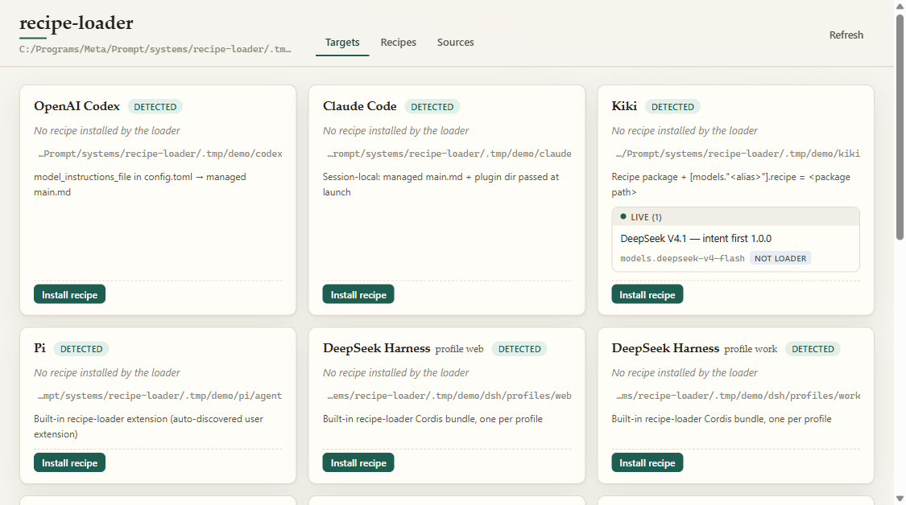

# recipe-switch

**Switch how your AI coding tools think and work.**  
*One click to install, switch, and roll back prompts, subagents, and per-turn reminders — with diff preview and byte-exact recovery.*

**English** · [简体中文](zh/index.md) · [Getting Started](getting-started.md) · [Harnesses](harnesses.md) · [Safety & Rollback](safety.md) · [Recipes & Options](recipes.md) · [FAQ](faq.md) · [GitHub](https://github.com/NB-Corp/recipe-switch)

---

## What is recipe-switch?

If you use tools like `cc-switch` to swap API providers across your coding agents, **recipe-switch** swaps the layer above the model: **how your AI coding tools reason, delegate, and stay on track.**

Changing how a coding agent behaves normally requires editing different files and plugins in every tool on your machine — `config.toml` in OpenAI Codex, launch flags and plugin hooks in Claude Code, `SYSTEM.md` in Kimi Code, extensions in Pi, or Cordis bundles in DeepSeek Harness. Worse, a real working style is never just one system prompt. It spans up to **six coordinated instruction slots**:

1. **Main** — system instructions for the primary interactive agent.
2. **Sub** — system instructions for delegated subagents.
3. **Independent** — system instructions for standalone/autonomous worker runs.
4. **User Steer** — short per-turn reminders injected on user turns.
5. **Sub Steer** — short per-turn reminders injected on subagent turns.
6. **Agent / Result Steer** — short reminders injected when a subagent or task returns a result.

We call that complete bundle a **recipe**.

**recipe-switch** is a zero-dependency Node.js (≥ 22) CLI and local portrait web UI (`127.0.0.1`) that installs, switches, customizes (via checkbox options), and rolls back recipes across **11 AI coding tools**.

---

## Core Guarantees

- **Preview every byte before writing.** Every CLI command defaults to dry-run mode and prints a unified diff. Nothing touches your disk until you pass `--yes` or click **Write changes** in the UI.
- **Hand-edit detection.** Managed files and config keys carry a `managed by recipe-switch` marker and a recorded fingerprint. If you edit a managed file by hand, `recipe-switch` blocks the switch or rollback instead of silently overwriting your edits. If you choose to force-overwrite, your hand-edited file is backed up first.
- **Byte-exact rollback, uninstall, and original backups.** Step back one change (`rollback`), remove everything and restore original config spans (`uninstall`), or inspect and restore your pre-install baseline (`originals` / `restore-original`).
- **Hands off your models and credentials.** `recipe-switch` never touches model selections, API keys, provider endpoints, MCP servers, or role definitions. Permissions stay untouched by default (OpenClaw's conversation-access hook key is only written when you explicitly check the opt-in box in the UI).

---

## Supported Tools at a Glance

| Tool | ID | Entry Mechanism | Steering Support |
| --- | --- | --- | --- |
| **OpenAI Codex** | `codex` | `model_instructions_file` in `config.toml` → `prompts/recipe-switch/{main,sub}.md` | Via `gpt-with-taste` `--hooks` plugin |
| **Claude Code** | `claude` | `recipe-switch/main.md` + `recipe-switch/plugin/` via launch command (settings untouched) | User, Sub, Agent Steer via plugin hooks |
| **Kiki** | `kiki` | Materialized package + `[models."<alias>"].recipe` in `config.toml` | Native Kiki Recipe steering |
| **Pi** | `pi` | Built-in extension `extensions/recipe-switch/` + hot-reloaded `recipe.json` | User, Sub, completed-result Steer |
| **DeepSeek Harness** | `dsh` | Built-in Cordis bundle `dsh-recipe-switch` per profile under `profiles/
/` | User, coordinator, subagent-report Steer |
| **Oh My Pi (OMP)** | `omp` | Extension `extensions/recipe-switch/` (`gpt-with-taste` OMP adapter) | User, Sub, completed Task Steer |
| **Grok Build** | `grok` | Global rule file `rules/recipe-switch.md` | None (Grok hooks cannot add context) |
| **OpenCode** | `opencode` | `recipe-switch/main.md` added to `instructions` array in `opencode.json` | None yet |
| **Kimi Code CLI** | `kimi-code` | Marked `SYSTEM.md` (`${base_prompt}` + Main) + `UserPromptSubmit` plugin | User Steer on user turns |
| **Hermes Agent** | `hermes` | `plugins/recipe-switch/` (`llm_request` middleware + `pre_llm_call` hook) | User Steer (main) & Sub Steer (children) |
| **OpenClaw** | `openclaw` | `extensions/recipe-switch/` (`before_prompt_build` plugin) + strict JSON enablement | Main/User Steer & Sub/Sub Steer |

*(Gemini CLI, Cursor, and Qoder are detected and listed as uncovered until safe global file entry points or adapters are finalized. See [Supported Harnesses](harnesses.md#not-covered-yet).)*

---

## Documentation Guide

- **[Installation & Quick Start](getting-started.md)** — Try the zero-risk `.tmp/demo` sandbox, run CLI dry runs, and use the local web UI.
- **[Supported Harnesses & Write Points](harnesses.md)** — Exact files, config keys, environment overrides, and runtime behaviors for all 11 tools.
- **[Safety, Backups & Rollback](safety.md)** — How diff previews, secret redaction, fingerprint drift checks, operation stacks, and original-state backups work.
- **[Recipes & Options Format (`recipe.toml`)](recipes.md)** — How to connect custom sources, write a `recipe.toml`, and define checkbox options (`when`/`unless`, `prepend`/`append`, and Markdown section patches).
- **[Frequently Asked Questions (FAQ)](faq.md)** — Answers to common questions about changing prompts in Claude Code, Codex, Kimi Code, Pi, Hermes, OpenClaw, and recovering from edits.
