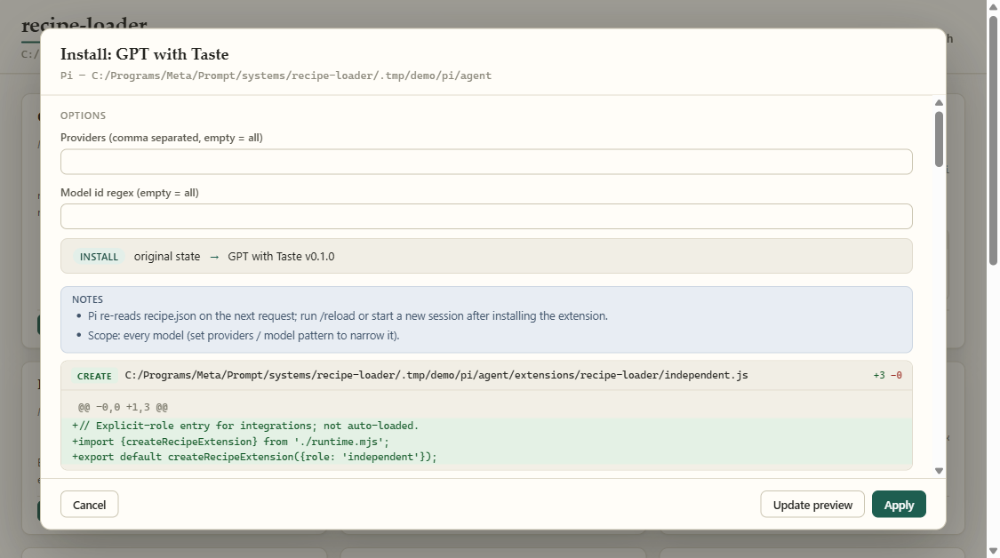
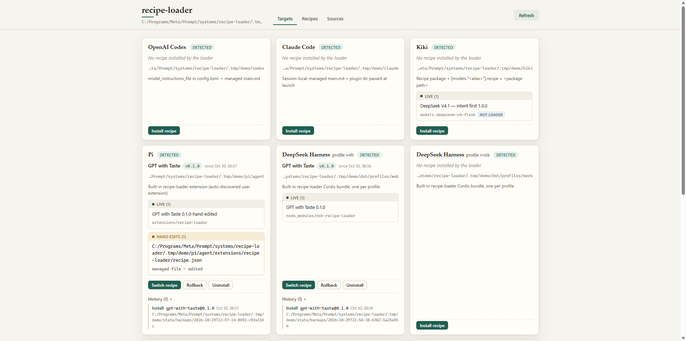
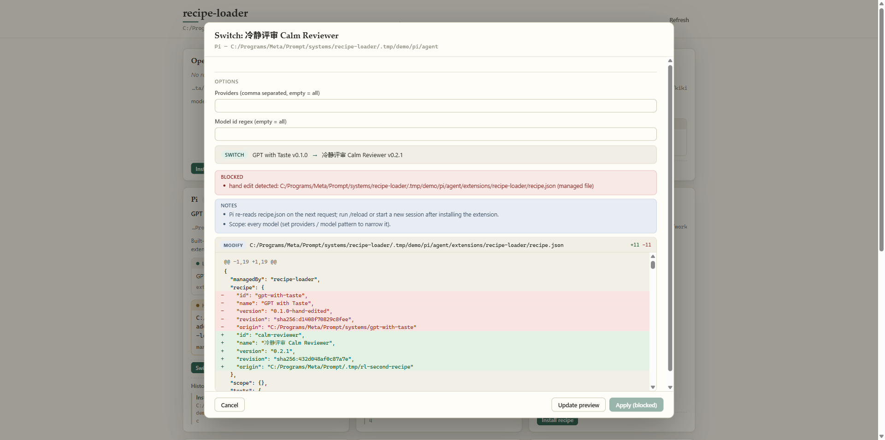
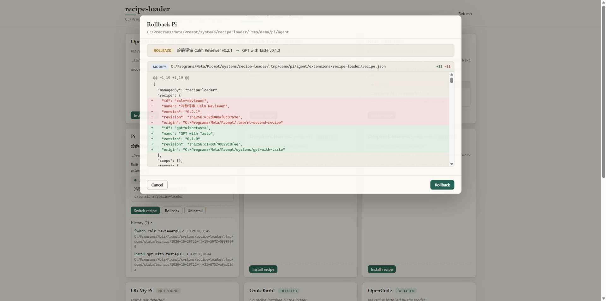
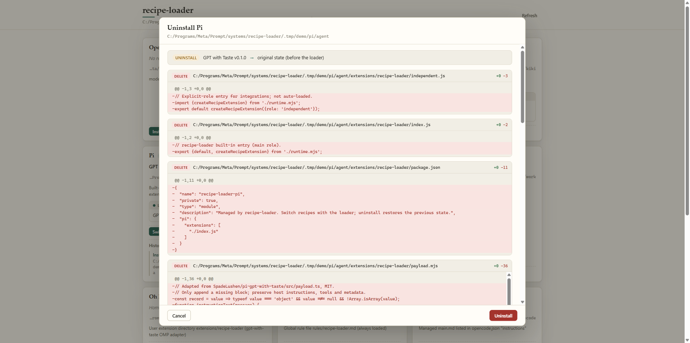

# Safety, Backups & Rollback

[Home](index.md) · [Getting Started](getting-started.md) · [Harnesses](harnesses.md) · **Safety & Rollback** · [Recipes & Options](recipes.md) · [FAQ](faq.md) · [简体中文](zh/safety.md)

---

`recipe-switch` edits configuration files inside your daily coding tools (`~/.codex`, `~/.claude`, `~/.kiki`, `~/.pi`, `~/.dsh`, `~/.kimi-code`, etc.). It is engineered so that **no write is a surprise, no manual edit is silently lost, and every change can be undone byte-for-byte.**

---

## 1. Dry-Run Diff Preview Before Every Write

Every command that modifies disk (`install`, `switch`, `rollback`, `uninstall`, `restore-original`) computes a full execution plan first:
- On the CLI, omitting `--yes` prints the exact unified diff (`+` / `-` line counts, file actions `CREATE`, `MODIFY`, `DELETE`, line-ending changes, and trailing newline changes) and exits without writing.
- In the Web UI, the bottom sheet renders the unified diff live as you toggle options.
- **Secret Redaction**: Any line in a diff matching patterns like `Authorization`, `Proxy-Authorization`, `x-api-key`, `api_key`, `cookie`, `set-cookie`, `auth`, `*token`, `*secret`, `*password`, or `Bearer ...` has its value replaced with `"[redacted]"` for display, while SHA-256 integrity checks still verify the real underlying bytes.
- **Stale Preview Rejection**: When you click **Write changes** or run with `--yes`, `recipe-switch` re-verifies the SHA-256 fingerprint of every target file. If any file changed on disk after the preview was generated, the apply aborts before writing a single byte.

---

## 2. Minimal, Marked Ownership (`src/units.mjs`)

`recipe-switch` never reformats an entire user config file just to change one setting. Each write is broken down into fine-grained **managed units**:

| Unit Type | What It Owns | How It Restores on Uninstall |
| --- | --- | --- |
| `file` | Whole files inside `recipe-switch`'s own directories (plus Kimi Code's marked `SYSTEM.md` wrapper) | Restores exact previous bytes, or deletes the file and cleans up empty created directories |
| `tomlKey` | A single `key = "…" # managed by recipe-switch` line inside a TOML table (`config.toml`) | Restores the exact previous line or removes the managed line while leaving the rest of the TOML file untouched |
| `jsonArrayItem` | One string item inside a JSON array (e.g., `opencode.json` → `instructions`, `openclaw.json` → `plugins.allow`, DSH `bundles`) | Restores the exact original source span (`jsonSpans`) including whitespace and indentation, and drops empty arrays/parent objects only if `recipe-switch` created them |
| `jsonKey` | One property inside a JSON object (e.g., OpenClaw `enabled`, DSH `dependencies`) | Restores the exact pre-edit lexical span or removes the created key/parent |
| `jsonArrayRecord` | One object matched by `"id": "recipe-switch"` inside a JSON array (`kimi-code` `installed.json`) | Restores the prior record raw span or removes the entry |
| `yamlArrayItem` | One block-list entry (`- recipe-switch`) under `plugins.enabled` in Hermes `config.yaml` | Applies the exact lexical `yamlPatch` or removes the item while preserving comments and surrounding keys |

---

## 3. Hand-Edit Detection ("Drift") & Foreign Guards

`recipe-switch` records the post-write fingerprint of every unit it manages.

- **Hand-edit drift**: If you open a managed `main.md`, edit `recipe.json`, or alter a `# managed by recipe-switch` line in `config.toml` by hand, `status` and the UI immediately flag the tool as **Edited / 有手改**.
- **Blocking on switch / rollback / uninstall**: Attempting to switch recipes, roll back, or uninstall when a file has hand-edit drift **stops with a blocked notice**.
- **Explicit backed-up override**: You can either move your manual edits out first, or explicitly override (`--force` on the CLI, or **Overwrite anyway (backed up)** in the UI). When forced, `recipe-switch` backs up your live hand-edited version into `~/.recipe-switch/backups/<op-id>/` and prints the exact path where your replaced version was saved.
- **Foreign installer guards**: If a target already has an unmanaged file at a managed path, or already loads `gpt-with-taste` via its standalone installer (`codex` receipt, `pi` package, `dsh-gpt-with-taste` bundle, or an unmanaged Kimi `SYSTEM.md`), `recipe-switch` blocks takeover until you restore the old installer or pass `--force`.

---

## 4. Reversible Transactions, Displaced Files & Crash Recovery (`src/engine.mjs`)

All state and backups live in `$RECIPE_SWITCH_HOME` (default `~/.recipe-switch`):
- `state.json` — per-target operation stack (`install` and `switch` records with full unit before/after snapshots).
- `backups/<op-id>/` — exact pre-write file copies plus `index.json` with SHA-256 digests and displaced old files.
- `pending.json` — durable write-ahead compensation journal.

Before mutating any target file:
1. A file lock serializes operations across concurrent CLI invocations and UI requests.
2. Canonical path checks (`assertBoundary`) verify that no symlink or Windows junction redirects any target file outside the harness home directory.
3. Pre-write copies are saved to `backups/<op-id>/` and `pending.json` is flushed to disk.
4. **Displaced old files (same-volume vs. cross-volume)**: When replacing an existing file on the **same disk volume**, the displaced old file is moved directly into the operation's `backups/<op-id>/` directory. If `recipe-switch`'s state directory and the target file live on **different volumes**, the displaced old file is kept right next to the target file, its path is recorded in the backup metadata and printed in the operation result, and `uninstall` will not delete it automatically so you can clean it up yourself.
5. If an error or crash interrupts a multi-file write before `state.json` commits, the very next command automatically runs `store.recover()`, reverting any partially written files back to their pre-operation bytes. (If you edited a file after the crash, recovery preserves your manual edit and reports the backup path for a manual decision.)

---

## 5. Rollback vs. Uninstall vs. Original State Backup

`recipe-switch` provides three ways to go back:

| Action | CLI Command | UI Button | What It Does |
| --- | --- | --- | --- |
| **Rollback one step** | `recipe-switch rollback <harness> [--yes]` | **Undo last change / 撤回上一步** | Pops the latest operation off the target's stack and restores the previous recipe (or the original state if only one recipe was installed). |
| **Uninstall** | `recipe-switch uninstall <harness> [--yes]` | **Restore / 还原** | Unwinds every operation in the target's stack in reverse order, restores original file bytes/spans, and removes empty directories created by `recipe-switch`. |
| **Original State Backup & Restore** | `recipe-switch originals <harness>` `recipe-switch restore-original <harness> [--yes]` | **原始备份 / 恢复到装之前** | Inspects or directly restores the baseline snapshot captured before `recipe-switch` ever modified the harness, regardless of how many switches or forced overrides happened since. |

### How Original State Backups Stay Tiny

Original state backups use almost no extra disk space:
- **Only modified existing files are snapshotted**: Only existing files that will be modified in place get a content snapshot; files that did not exist before installation are simply recorded as "originally absent".
- **Content-addressed deduplication**: Snapshot contents are stored once by SHA-256 — identical content is never duplicated.
- **Written once, released cleanly**: The original snapshot is captured only on the very first write to a target. Stored content blobs are kept until the tool is restored to its pre-install state and completely uninstalled, at which point unreferenced blobs are released.

