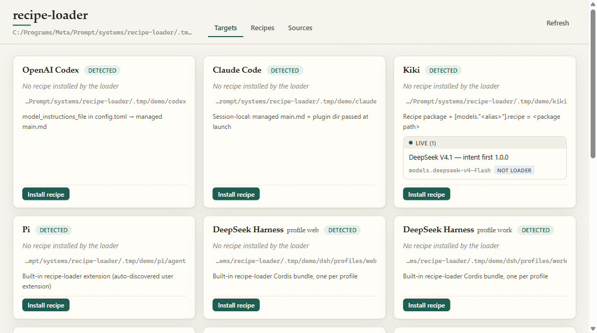

# recipe-switch

**一键切换 AI 编程工具的整套工作方式。**  
*主提示词、子代理分工与每轮纠偏提醒，先看 diff 再落盘，随时逐字节还原。*

[English](../index.md) · **简体中文** · [安装与快速开始](getting-started.md) · [各工具说明](harnesses.md) · [安全与回滚](safety.md) · [配方与选项格式](recipes.md) · [常见问题 FAQ](faq.md) · [GitHub](https://github.com/NB-Corp/recipe-switch)

---

## recipe-switch 是什么？

如果你用过 `cc-switch` 来给不同的 AI 编程工具切换底层模型和 API 供应商（provider），那么 **recipe-switch** 切的就是模型之上的行为层：**让你的 AI 编程工具换一套思考、拆解任务、调度子代理和保持方向的工作方式。**

平时想改编程工具的行为，往往得去十几个工具各自的目录里翻找不同的配置文件和插件机制：Codex 改 `config.toml`，Claude Code 传启动参数和 hook 插件，Kimi Code 改 `SYSTEM.md` 和插件表，Pi 装扩展，DeepSeek Harness 挂 Cordis bundle。更重要的是，一套真正好用的工作方式从来不只是一段孤立的系统提示词，它包含最多**六个协同配合的文本槽位**：

1. **主代理提示词（Main）** — 主交互会话的系统指令。
2. **子代理提示词（Sub）** — 派发出去的子代理（subagent）系统指令。
3. **独立代理提示词（Independent）** — 独立执行完整任务时的系统指令。
4. **用户回合提醒（User Steer）** — 用户每轮发消息时附带的短提醒（steering）。
5. **子代理回合提醒（Sub Steer）** — 子代理每轮执行时附带的短提醒。
6. **结果回合提醒（Agent / Result Steer）** — 子代理或后台任务返回结果时的短提醒。

我们把这六个槽位及可选的复选框开关打包在一起，称为一份**配方（Recipe）**。

**recipe-switch** 是一个零 npm 依赖的 Node.js（≥ 22）命令行工具与本地竖屏 Web 小面板（仅监听 `127.0.0.1`），支持在 **11 款 AI 编程工具（harness）** 上一键安装、切换、勾选定制和回滚配方。

---

## 核心安全承诺

- **写入前必看 Diff 预览。** 所有改写磁盘的命令默认都是预览模式（dry run），清晰列出每个文件的增删行。只有加上 `--yes` 或在 Web 面板点击**"确认写入"**才会落盘。
- **手改检测，绝不静默覆盖。** 托管的文件与配置行带有 `managed by recipe-switch` 标记和指纹校验。只要你手动改过受管文件，切换、撤回或还原都会立刻停下并提示你；确认强制覆盖时，会先把你的手改版本完整备份下来。
- **逐字节回滚、卸载与原始备份恢复。** 支持撤回上一步（`rollback`）、卸载并还原所有配置跨度（`uninstall`），以及查看和恢复首次安装前的原始状态备份（`originals` / `restore-original`，UI 中的**"原始备份 / 恢复到装之前"**）。
- **绝不触碰模型、认证与无关权限。** 不改模型选择、API Key、provider、MCP 或角色定义。默认不改任何权限（OpenClaw 的对话访问权限仅在你在 UI 主动勾选授权后才会写入，且卸载时自动还原）。

---

## 支持的工具一览

| 工具 | ID | 接入方式 | 每轮提醒（Steering） |
| --- | --- | --- | --- |
| **OpenAI Codex** | `codex` | `config.toml` 的 `model_instructions_file` → `prompts/recipe-switch/{main,sub}.md` | 由 `gpt-with-taste` 自身的 `--hooks` 插件提供 |
| **Claude Code** | `claude` | `recipe-switch/main.md` + `recipe-switch/plugin/`，输出启动命令（不改 `settings.json`） | 通过随附插件 hooks 注入用户、子代理与结果提醒 |
| **Kiki** | `kiki` | 展开后的配方包 + `config.toml` 中指定模型的 `recipe = "<package>"` | Kiki 原生 Recipe steering |
| **Pi** | `pi` | 内置扩展 `extensions/recipe-switch/` + 自动热读的 `recipe.json` | 用户、子代理与已完成结果提醒 |
| **DeepSeek Harness** | `dsh` | 每个 profile 下的内置 Cordis bundle `dsh-recipe-switch` | `agent/pre-step` 注入用户、协调器与子代理汇报提醒 |
| **Oh My Pi (OMP)** | `omp` | 扩展目录 `extensions/recipe-switch/`（`gpt-with-taste` OMP 适配器） | 通过适配器注入用户、子代理与任务提醒 |
| **Grok Build** | `grok` | 全局规则文件 `rules/recipe-switch.md` | 无（Grok hooks 无法追加模型上下文） |
| **OpenCode** | `opencode` | `recipe-switch/main.md` 加入 `opencode.json` 的 `instructions` 数组 | 暂未接入 |
| **Kimi Code CLI** | `kimi-code` | 带标记的 `SYSTEM.md`（保留 `${base_prompt}` + Main）+ `UserPromptSubmit` 插件 | 用户回合重读并注入用户提醒 |
| **Hermes Agent** | `hermes` | `plugins/recipe-switch/`（`llm_request` 中间件 + `pre_llm_call` 钩子） | 主会话用户提醒 + 委派子代理提醒 |
| **OpenClaw** | `openclaw` | `extensions/recipe-switch/`（`before_prompt_build` 插件）+ 严格 JSON 配置启用 | 常规会话 Main/用户提醒，子代理会话 Sub/子代理提醒 |

*(Gemini CLI、Cursor 和 Qoder 会被检测并列在"暂不支持"中，原因详见[各工具说明](harnesses.md#尚未覆盖的工具)。)*

---

## 文档导航

- **[安装与快速开始](getting-started.md)** — 运行零风险的 `.tmp/demo` 沙盒演示、CLI 预览安装与本地 Web 面板使用指南。
- **[各工具写入点与限制说明](harnesses.md)** — 11 款工具的具体写入文件、配置键、环境变量覆盖与运行机制。
- **[安全模型、备份与回滚](safety.md)** — Diff 预览、敏感字段脱敏、手改指纹检测、事务恢复与"原始备份 / 恢复到装之前"详解。
- **[配方与选项格式（`recipe.toml`）](recipes.md)** — 如何接入自定义配方源、编写 `recipe.toml`，以及使用 `when`/`unless`、`prepend`/`append` 和 Markdown 章节修补选项。
- **[常见问题（FAQ）](faq.md)** — 关于修改 Claude Code、Codex、Kimi Code、Pi、Hermes、OpenClaw 提示词及回滚恢复的常见疑问解答。
